=========================================================================================================================

# 1. What are the four pillars of Object-Oriented Programming?
 The four pillars of Object-Oriented Programming (OOP) in Java are:
1. Encapsulation
2. Abstraction
3. Inheritance
4. Polymorphism
Let's understand each concept with a simple definition, Java example, and a real-world Spring Boot scenario.
1. Encapsulation
Definition: Encapsulation means wrapping data (variables) and methods into a single class and restricting direct access to the data.

Java example:
class Employee {
    private double salary;

    public double getSalary() {
        return salary;
    }

    public void setSalary(double salary) {
        if (salary > 0) {
            this.salary = salary;
        }
    }
}

- private prevents direct access to salary from outside the class.
- Getter and setter methods provide controlled access.
Real-world example: An employee's salary should not be modified directly without applying the required business rules.
2. Abstraction
Definition: Abstraction means hiding implementation details and exposing only essential functionality.

Java example:
interface PaymentService {
    void pay(double amount);
}

class UpiPaymentService implements PaymentService {
    @Override
    public void pay(double amount) {
        System.out.println("Processing UPI payment");
    }
}

The caller knows how to invoke pay() without needing to understand the internal payment-processing logic.

Real-world example: In a Spring Boot application, a controller calls a PaymentService interface without needing to know how UPI transactions are processed internally.
3. Inheritance
Definition: Inheritance allows one class to acquire accessible fields and methods from another class using extends.

Java example:
class Employee {
    void work() {
        System.out.println("Employee is working");
    }
}

class Developer extends Employee {
    void writeCode() {
        System.out.println("Developer is writing code");
    }
}

Developer developer = new Developer();
developer.work();
developer.writeCode();

The Developer class inherits the accessible work() method from Employee.

Real-world example: Different employee types can share common employee functionality.
4. Polymorphism
Definition: Polymorphism means one interface or method call can represent different behaviors.

There are two main types:
- Compile-time polymorphism: Method overloading.
- Runtime polymorphism: Method overriding.
Java example — runtime polymorphism:
interface NotificationService {
    void send();
}

class EmailService implements NotificationService {
    public void send() {
        System.out.println("Sending Email");
    }
}

class SmsService implements NotificationService {
    public void send() {
        System.out.println("Sending SMS");
    }
}

NotificationService service = new EmailService();
service.send(); // Sending Email

service = new SmsService();
service.send(); // Sending SMS

Real-world example: A notification system can send email or SMS through the same interface, with each implementation providing different behavior.

Interview-ready answer
If an interviewer asks, “What are the four pillars of OOP?”, you can answer:
The four pillars of Object-Oriented Programming are encapsulation, abstraction, inheritance, and polymorphism. Encapsulation protects data by controlling access to it. Abstraction hides implementation details and exposes essential functionality. Inheritance enables code reuse by allowing one class to extend another. Polymorphism allows the same interface or method call to exhibit different behaviors. These concepts help us build maintainable, reusable, and extensible Java applications.

Quick revision
Pillar	Key concept	Java mechanism
Encapsulation	Data protection	Access modifiers, methods
Abstraction	Hide implementation details	Interfaces, abstract classes
Inheritance	Reuse common behavior	extends
Polymorphism	Different implementations	Overloading, overriding

=========================================================================================================================

# 2. What is the difference between abstraction and encapsulation?

The main difference is:
- Abstraction = Hiding implementation details.
- Encapsulation = Protecting data by controlling access to it.
Let's understand both step by step as a beginner.
1. Abstraction — hiding the details
Real-life example: When you drive a car, you press the brake to stop it. You don't need to know how the braking system works internally.

Java example:
interface Vehicle {
    void start();
}

class Car implements Vehicle {
    public void start() {
        System.out.println("Car started");
    }
}

Here, Vehicle defines what the vehicle can do. The Car class defines how it does it.

Remember: Abstraction hides how something works.
2. Encapsulation — protecting the data
Real-life example: In a bank account, you cannot directly change your balance. You must use permitted operations, such as depositing money.

Java example:
class BankAccount {
    private double balance = 1000;

    public double getBalance() {
        return balance;
    }

    public void deposit(double amount) {
        if (amount > 0) {
            balance = balance + amount;
        }
    }
}

Here:
- private prevents direct access to balance from outside the class.
- deposit() controls how the balance is changed.
- The method rejects invalid deposit amounts.
Remember: Encapsulation protects the data and how it changes.
3. Difference between them
Abstraction	                                    Encapsulation
Hides implementation details	                Protects internal data
Focuses on what an object does	                Focuses on controlling access
Commonly uses interfaces and abstract classes	Commonly uses access modifiers and methods
Example: Vehicle interface	                    Example: private balance

Easy trick to remember
Abstraction → Hiding complexity.

Encapsulation → Protecting data.

=========================================================================================================================
3. What is the difference between an abstract class and an interface?
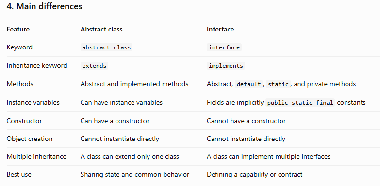
=========================================================================================================================

4. What is the difference between method overloading and method overriding?
First, remember this simple rule:
- Method Overloading = Same method name, different parameters.
- Method Overriding = Child class changes the implementation of a parent class method.
Both are types of polymorphism in Java.
1. Method Overloading
Simple meaning
Method overloading means creating multiple methods with the same name but different parameter lists.

Think of a calculator. You use the same operation, add(), to add different types or numbers of values.
Java example
class Calculator {

    int add(int a, int b) {
        return a + b;
    }

    int add(int a, int b, int c) {
        return a + b + c;
    }

    double add(double a, double b) {
        return a + b;
    }
}

Call the methods:
Calculator calculator = new Calculator();

System.out.println(calculator.add(10, 20));
System.out.println(calculator.add(10, 20, 30));
System.out.println(calculator.add(10.5, 20.5));

Output:
30
60
31.0

Understand these points:
- All three methods have the same name: add().
- Their parameter lists are different.
- The compiler chooses the appropriate method based on the arguments and overload resolution rules.
- Overloading can happen in the same class; inheritance is not required.
Important: Changing only the return type does not create a valid overload.
int add(int a, int b) {
    return a + b;
}

// Invalid overload: same parameter types
double add(int a, int b) {
    return a + b;
}

2. Method Overriding
Simple meaning
Method overriding means a child class provides its own implementation of a method inherited from its parent class.

Think of an animal. Different animals make different sounds, even though they share the same operation: makeSound().
Java example
class Animal {

    void makeSound() {
        System.out.println("Animal makes a sound");
    }
}

class Dog extends Animal {

    @Override
    void makeSound() {
        System.out.println("Dog barks");
    }
}

class Cat extends Animal {

    @Override
    void makeSound() {
        System.out.println("Cat meows");
    }
}

Call the methods:
Animal animal = new Dog();
animal.makeSound();

animal = new Cat();
animal.makeSound();

Output:
Dog barks
Cat meows

Understand these points:
- The parent class defines makeSound().
- The child classes provide their own implementations.
- The method signature must match the inherited method, subject to Java's overriding rules.
- The actual object's implementation is selected at runtime.
3. Main differences
   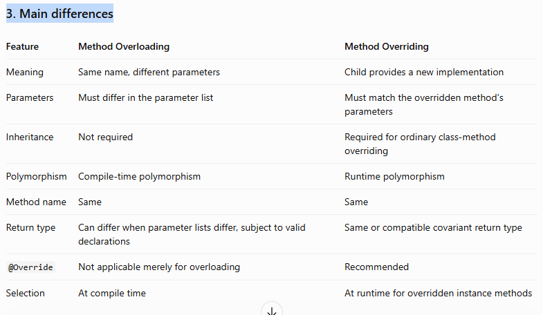

=========================================================================================================================

5. Does Java support multiple inheritance?
Answer: Java does not support multiple inheritance through classes, but it supports multiple inheritance through interfaces.

Let's understand this step by step.
1. What is Multiple Inheritance?
Multiple inheritance means one child class inherits from two or more parent classes.

For example, imagine a child class inherits properties and methods from both Father and Mother.
2. Multiple Inheritance Using Classes ❌
Java does not allow this:

class Father {
    void property() {
        System.out.println("Father's property");
    }
}

class Mother {
    void property() {
        System.out.println("Mother's property");
    }
}

// Invalid Java: a class cannot extend two classes
class Child extends Father, Mother {
}

This code produces a compilation error because Java does not allow a class to extend two classes.
Why does Java not support it?
One important reason is the Diamond Problem.

Suppose both parent classes have a method named property(). When Child calls that method, which parent's implementation should it use?

Java avoids this ambiguity by not allowing multiple inheritance of classes.
3. Multiple Inheritance Using Interfaces ✅
Java allows a class to implement multiple interfaces.
interface Printable {
    void print();
}

interface Showable {
    void show();
}

class Document implements Printable, Showable {

    @Override
    public void print() {
        System.out.println("Printing document");
    }

    @Override
    public void show() {
        System.out.println("Showing document");
    }
}

We can use both functionalities:
Document document = new Document();

document.print();
document.show();

Output:
Printing document
Showing document

Here, Document implements both Printable and Showable.

Remember: One class can extend only one class, but it can implement multiple interfaces.
4. Real-world Spring Boot example
Imagine an e-commerce application where a document service needs to print documents and store them.
interface Printable {
    void print();
}

interface Storable {
    void store();
}

class InvoiceService implements Printable, Storable {

    @Override
    public void print() {
        System.out.println("Printing invoice");
    }

    @Override
    public void store() {
        System.out.println("Storing invoice");
    }
}

The InvoiceService class can provide both capabilities without extending multiple classes.

In a real Spring Boot application, these interfaces can represent separate capabilities, and Spring can inject their implementations where required.
5. Important interview point
Interfaces can contain default methods with implementations. If a class implements two interfaces that provide conflicting default methods with the same signature, the class generally must override the conflicting method to resolve the ambiguity.

So, Java does not completely eliminate every possible method conflict; it provides rules to resolve them.
6. Interview-ready answer
Java does not support multiple inheritance through classes because it can cause ambiguity, known as the Diamond Problem. However, Java supports multiple inheritance through interfaces, where one class can implement multiple interfaces. For example, an InvoiceService class can implement both Printable and Storable. This allows us to combine multiple capabilities without inheriting from multiple classes.

Quick memory trick
Inheritance type	Supported in Java?
One class extends one class	✅ Yes
One class extends multiple classes	❌ No
One class implements one interface	✅ Yes
One class implements multiple interfaces	✅ Yes

=========================================================================================================================

6. Why does Java not support multiple inheritance through classes?

Answer: Java does not support multiple inheritance through classes mainly to avoid ambiguity and complexity, especially the Diamond Problem.
Let's understand it step by step.
1. Understand with a simple example
Imagine two parent classes, Father and Mother. Both have a method called property().
- Father says: "This is Father's property."
- Mother says: "This is Mother's property."
Now, suppose Child inherits from both classes. When the child calls property(), which parent's method should execute?

Java avoids this ambiguity by not allowing a class to extend multiple classes.
4. How does Java handle this?
Java provides two simple rules:
- A class can extend only one class.
- A class can implement multiple interfaces.
Quick memory trick
Multiple classes → Not allowed.

Multiple interfaces → Allowed.

=========================================================================================================================
7. What is the difference between compile-time and runtime polymorphism?
First, remember this simple rule:
- Compile-time polymorphism = Method Overloading
- Runtime polymorphism = Method Overriding
1. Compile-Time Polymorphism
Simple meaning
Compile-time polymorphism happens when Java decides which overloaded method to call during compilation.

It is achieved through method overloading.

Remember: Same method name + different parameters = Overloading = Compile-time polymorphism.

2. Runtime Polymorphism
Simple meaning
Runtime polymorphism happens when Java decides which overridden method to execute while the program is running.

It is achieved through method overriding.
Remember: Same method + overridden implementation + actual object determines behavior = Runtime polymorphism.

3. Main Differences
   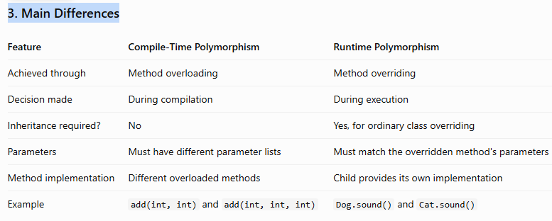

=========================================================================================================================
8. What is the difference between this and super?
First, remember this simple rule:
- this = Refers to the current object.
- super = Refers to the parent class part of the current object.
Let's understand both step by step using simple Java examples.
1. this keyword
Simple meaning
The this keyword refers to the current object.

It is commonly used when a local variable or constructor parameter has the same name as an instance variable.
2. super keyword
Simple meaning
The super keyword is used in a subclass to access accessible members of its parent class.

It is commonly used when a child class needs to call a parent constructor or a parent method.
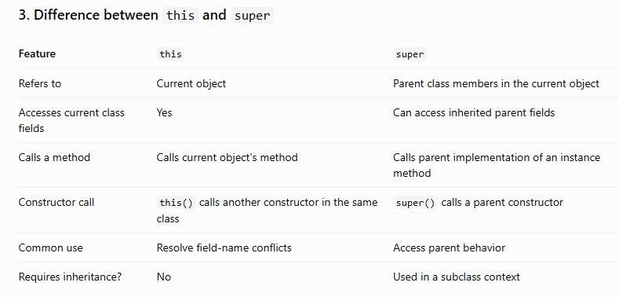
=========================================================================================================================
9. What is the difference between final, finally, and finalize()?
9. What is the difference between final, finally, and finalize() in Java?
First, remember this simple rule:
- final → Restricts changes.
- finally → Executes cleanup code after try/catch, in normal circumstances.
- finalize() → An old garbage-collection-related method that should not be used.
Although these three names look similar, they have completely different purposes.
1. final — Restricting changes
The final keyword is used with variables, methods, and classes.
A. Final variable
Once a variable has been assigned, you cannot assign a new value to it.
final int age = 25;

// age = 30;  // Compilation error

B. Final method
A child class cannot override a final method.
class Animal {
    final void eat() {
        System.out.println("Animal is eating");
    }
}

class Dog extends Animal {
    // Cannot override eat() here
}

C. Final class
A final class cannot be extended.
final class Vehicle {
}

// class Car extends Vehicle { } // Compilation error

Remember: final prevents reassignment of a variable, overriding of a method, or inheritance of a class, depending on where it is used.

One important detail: making an object reference final does not automatically make the object itself immutable.
final StringBuilder text = new StringBuilder("Hello");

text.append(" Java");  // Allowed
// text = new StringBuilder("New"); // Not allowed

The reference cannot point to a different object, but the existing StringBuilder can still be modified.
2. finally — Running cleanup code
The finally block is used with try and catch. It normally executes whether an exception occurs or not.
Java example
class Demo {
    public static void main(String[] args) {
        try {
            int result = 10 / 0;
        } catch (ArithmeticException e) {
            System.out.println("Exception handled");
        } finally {
            System.out.println("Cleanup completed");
        }
    }
}

Output:
Exception handled
Cleanup completed

How does it work?
- try contains code that might cause an exception.
- catch handles the exception.
- finally runs cleanup code after the try/catch flow.
Real-world example: Closing files or releasing resources. In modern Java, prefer try-with-resources for resources that implement AutoCloseable.

Note: finally is not guaranteed to execute if the JVM terminates abruptly, such as through System.exit().
3. finalize() — An old cleanup method
Historically, finalize() was a method that the garbage collector might call when an object became eligible for garbage collection.
Example for understanding only
class Demo {
    @Override
    protected void finalize() {
        System.out.println("Finalize method called");
    }
}

In older explanations, you might see this:
Demo obj = new Demo();
obj = null;
System.gc();

However, you cannot rely on finalize() being called. Setting obj = null does not guarantee when the object will be collected, and System.gc() does not guarantee collection either.

Important for modern Java: Object.finalize() has been deprecated since Java 9 and is marked for removal in Java SE 26. Avoid using it in production code. Use try-with-resources and AutoCloseable for explicit resource cleanup instead. 

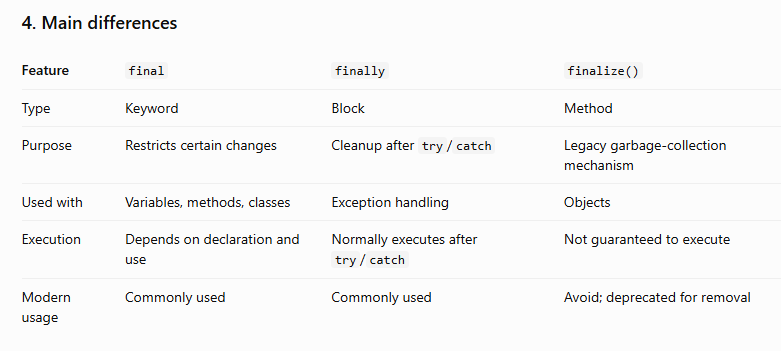

=========================================================================================================================

10. Can a constructor be private?

Yes, a constructor can be private in Java.

A private constructor means that objects of that class cannot be created directly using new from outside that class.

Let's understand this step by step.
1. Simple Java example
class Employee {

    private Employee() {
        System.out.println("Constructor called");
    }
}

Now try creating an object from another class:
Employee emp = new Employee();

Result: Compilation error, because the constructor is private.

Remember: A private constructor restricts object creation from outside the class. The class itself can still call its private constructor.
2. Why do we use a private constructor?
There are several common reasons:
- Singleton design pattern
- Utility classes
- Controlling object creation through factory methods
Let's understand these with examples.
A. Singleton design pattern
A Singleton is designed to provide one shared instance of a class.
class Singleton {

    private static final Singleton INSTANCE = new Singleton();

    private Singleton() {
        // Prevent direct construction from outside
    }

    public static Singleton getInstance() {
        return INSTANCE;
    }
}

Usage:
Singleton obj1 = Singleton.getInstance();
Singleton obj2 = Singleton.getInstance();

System.out.println(obj1 == obj2); // true

How does it work?
1. The constructor is private, so outside classes cannot call it directly.
2. The class creates one instance internally.
3. The public static method returns that instance.
This is a simple eager-initialization Singleton example.
B. Utility class
A utility class provides helper methods and usually does not need objects.
class CalculatorUtil {

    private CalculatorUtil() {
        // Prevent object creation
    }

    public static int add(int a, int b) {
        return a + b;
    }
}

Usage:
int result = CalculatorUtil.add(10, 20);
System.out.println(result);

Output:
30

We call add() using the class name without creating a CalculatorUtil object.
C. Factory method
Sometimes a class controls how its objects are created by exposing a static factory method.
class Employee {

    private String name;

    private Employee(String name) {
        this.name = name;
    }

    public static Employee create(String name) {
        return new Employee(name);
    }

    public String getName() {
        return name;
    }
}

Usage:
Employee emp = Employee.create("Rahul");

System.out.println(emp.getName());

Output:
Rahul

Here, the private constructor prevents direct external construction, while create() provides a controlled way to create an object.
3. Interview-ready answer
You can remember and say:
Yes, a constructor can be private in Java. A private constructor prevents objects from being created directly outside the class. It is commonly used in the Singleton design pattern, utility classes, and factory methods where we want to control object creation. For example, in a Singleton class, we use a private constructor and provide a public static method to return the shared instance.

Quick memory trick
Private constructor → Control object creation.
=========================================================================================================================
11. Can a constructor be overridden or inherited in Java?
Answer: No. A constructor cannot be overridden or inherited in Java. However, constructors can be overloaded.

Let's understand each point with simple examples.
1. Can a constructor be overridden? ❌ No
Meaning: Overriding happens when a child class provides its own implementation of an inherited parent-class method.

But constructors are not inherited, so they cannot be overridden.
Java example
class Animal {

    Animal() {
        System.out.println("Animal constructor");
    }
}

class Dog extends Animal {

    Dog() {
        System.out.println("Dog constructor");
    }
}

Create an object:
Dog dog = new Dog();

Output:
Animal constructor
Dog constructor

What happens here?
1. The Dog constructor starts.
2. The parent constructor executes through an implicit super() call.
3. The Dog constructor body executes.
The Dog() constructor is not overriding Animal(). They are separate constructors belonging to separate classes.
2. Can a constructor be inherited? ❌ No
A child class does not automatically inherit the constructor of its parent class.
class Employee {

    Employee(String name) {
        System.out.println("Employee: " + name);
    }
}

class Developer extends Employee {

    Developer(String name) {
        super(name);
    }
}

Usage:
Developer developer = new Developer("Rahul");

Output:
Employee: Rahul

Here, Developer defines its own constructor and explicitly calls the parent constructor using super(name).

Remember: super(name) calls the parent constructor; it does not inherit that constructor into the child class.
3. Can a constructor be overloaded? ✅ Yes
Constructor overloading means defining multiple constructors in the same class with different parameter lists.
class Employee {

    Employee() {
        System.out.println("Default constructor");
    }

    Employee(String name) {
        System.out.println("Employee: " + name);
    }

    Employee(String name, int age) {
        System.out.println(name + ", " + age);
    }
}

Usage:
new Employee();
new Employee("Rahul");
new Employee("Rahul", 30);

Each constructor is selected according to the arguments provided.
4. Quick comparison
Concept	Supported?	Reason
Constructor overriding	❌ No	Constructors are not inherited
Constructor inheritance	❌ No	Each class has its own constructors
Constructor overloading	✅ Yes	A class can define multiple parameter lists
Parent constructor call	✅ Yes	Use super() or super(arguments)

=========================================================================================================================
12. What happens if a constructor throws an exception in Java?
Simple answer: If a constructor throws an exception, object creation fails, and the exception is passed to the caller to handle.

Let's understand this step by step.
1. Simple Java example
class Employee {

    Employee() {
        System.out.println("Constructor started");

        throw new RuntimeException("Something went wrong");

        // System.out.println("Constructor completed");
    }
}

The last println() is commented out because Java does not allow reachable code after an unconditional throw.

Now create an object:
try {
    Employee emp = new Employee();
} catch (RuntimeException e) {
    System.out.println(e.getMessage());
}

Output:
Constructor started
Something went wrong

What happened?
1. Java started executing the constructor.
2. The constructor threw an exception.
3. The constructor stopped executing.
4. The exception reached the catch block.
5. The object was not successfully created for the caller.
2. What happens to the object?
Consider this code:
Employee emp = new Employee();

If the constructor throws an exception, the assignment to emp does not complete.

This means the caller does not receive the newly created object through that assignment. The object's memory may have been allocated, but it is not returned as a successfully constructed object. Normally, such an object can later be garbage-collected if it is no longer reachable.

Important: If the constructor allows this to escape—for example, by publishing the reference elsewhere before throwing—other code might still see a partially initialized object. Avoid doing this.
3. What if the constructor throws a checked exception?
A checked exception must be caught or declared.
import java.io.IOException;

class FileService {

    FileService() throws IOException {
        throw new IOException("Unable to initialize file service");
    }
}

The caller must handle or declare the exception:
try {
    FileService service = new FileService();
} catch (IOException e) {
    System.out.println(e.getMessage());
}

If the constructor throws an unchecked exception, such as RuntimeException, the caller is not required to catch or declare it.
4. What if a parent constructor throws an exception?
class Animal {
    Animal() {
        System.out.println("Animal constructor");
        throw new RuntimeException("Parent initialization failed");
    }
}

class Dog extends Animal {
    Dog() {
        System.out.println("Dog constructor");
    }
}

When we execute:
new Dog();

Output:
Animal constructor

The exception from the parent constructor prevents normal completion of object creation. The Dog constructor body does not continue.
5. Real-world example
Imagine a Spring Boot application creating a payment client. During initialization, the constructor validates a required configuration value. If that value is invalid and the constructor throws an exception, the object is not successfully constructed. If Spring is creating that bean, application initialization may fail as a result.

For reliable resource management, avoid acquiring resources in constructors unless necessary. If initialization can fail after resources have been acquired, ensure those resources are cleaned up properly.
6. Interview-ready answer
If a constructor throws an exception, object creation does not complete successfully, and the exception propagates to the caller unless it is handled. Any remaining constructor statements are skipped. If a parent constructor throws an exception, the child constructor body does not execute normally. Checked exceptions must be caught or declared, whereas unchecked exceptions do not require this. In production, I also ensure that resources acquired during initialization are properly cleaned up if construction fails.
=========================================================================================================================
13. What is the difference between Static and Instance Members in Java?
First, remember this simple rule:
- Static members → Belong to the class and are shared.
- Instance members → Belong to each object separately.
In Java, members means variables and methods declared inside a class.
1. Static members
Simple meaning
A static member belongs to the class itself, not to an individual object.

You can access a static member using the class name without creating an object.
Java example
class Employee {

    static String company = "ABC Company";

    static void displayCompany() {
        System.out.println(company);
    }
}

Call the static method:
Employee.displayCompany();

System.out.println(Employee.company);

Output:
ABC Company
ABC Company

How does it work?
- static String company is a static variable.
- static void displayCompany() is a static method.
- Both belong to the Employee class.
- All employees share the same company variable.
Remember: Static = Shared at class level.
2. Instance members
Simple meaning
An instance member belongs to an individual object.

Every object has its own copy of instance variables.
Java example
class Employee {

    String name;

    void displayName() {
        System.out.println(name);
    }
}

Create two objects:
Employee emp1 = new Employee();
emp1.name = "Rahul";

Employee emp2 = new Employee();
emp2.name = "Priya";

emp1.displayName();
emp2.displayName();

Output:
Rahul
Priya

How does it work?
- name is an instance variable.
- displayName() is an instance method.
- emp1 has its own name: Rahul.
- emp2 has its own name: Priya.
Remember: Instance = Each object has its own state.
3. Understand both together
This example shows a static variable shared by two objects and an instance variable that differs for each object.
class Employee {

    static String company = "ABC Company";

    String name;

    void display() {
        System.out.println(name + " works at " + company);
    }
}

Usage:
Employee emp1 = new Employee();
emp1.name = "Rahul";

Employee emp2 = new Employee();
emp2.name = "Priya";

emp1.display();
emp2.display();

Output:
Rahul works at ABC Company
Priya works at ABC Company

Both employees have different names, but they share the same company.

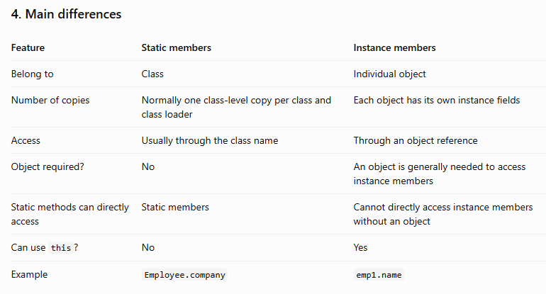
=========================================================================================================================
14. Can a static method be overridden in Java?
Answer: No, a static method cannot be overridden in Java. It can be hidden by a static method in a child class.

Let's understand this step by step.
1. What is a static method?
A static method belongs to the class, not to an individual object.
class Parent {

    static void display() {
        System.out.println("Parent static method");
    }
}

You can call it using the class name:
Parent.display();

Output:
Parent static method

2. Can a child class override a static method?
No. When a child class defines a static method with the same signature as the parent's static method, this is called method hiding, not overriding.
Java example
class Parent {

    static void display() {
        System.out.println("Parent static method");
    }
}

class Child extends Parent {

    static void display() {
        System.out.println("Child static method");
    }
}

Now call the methods:
Parent.display();
Child.display();

Output:
Parent static method
Child static method

Both methods are associated with their respective classes.
3. What happens when we use a parent reference?
This is an important interview question.
Parent obj = new Child();
obj.display();

Output:
Parent static method

Why?

Because static method selection depends on the reference's declared type at compile time, not on the actual object's type at runtime.

Here, obj is declared as Parent, so Parent.display() is selected.

Remember: Static method = Method hiding, not overriding.
4. What happens with an instance method?
Instance methods can be overridden.
class Parent {

    void show() {
        System.out.println("Parent instance method");
    }
}

class Child extends Parent {

    @Override
    void show() {
        System.out.println("Child instance method");
    }
}

Call it:
Parent obj = new Child();
obj.show();

Output:
Child instance method

Here, Java selects the overridden method based on the actual object at runtime.
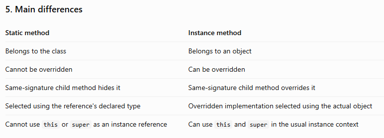
=========================================================================================================================
15. What is Method Hiding in Java?
Simple answer: Method hiding happens when a child class defines a static method with the same method signature as a static method in its parent class.

Remember:
- Static method → Method hiding
- Instance method → Method overriding
Let's understand with a simple example.
1. Java example
class Parent {

    static void display() {
        System.out.println("Parent method");
    }
}

class Child extends Parent {

    static void display() {
        System.out.println("Child method");
    }
}

Both classes have a static method named display().

Now call the methods:
Parent.display();
Child.display();

Output:
Parent method
Child method

Why?
- Parent.display() calls the static method declared in Parent.
- Child.display() calls the static method declared in Child.
The child's method hides the parent's method when accessed through the child class.
2. Important interview example
What happens here?
Parent obj = new Child();

obj.display();

Output:
Parent method

Why does it print Parent method instead of Child method?

Because static method selection depends on the declared reference type, not the actual object created.

Here:
- Reference type = Parent
- Actual object type = Child
- Selected static method = Parent.display()
This is different from overriding, where the actual object determines which overridden instance method executes.
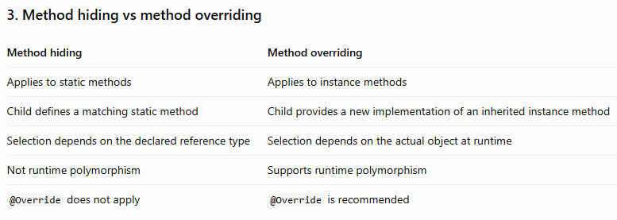
=========================================================================================================================
16. What is the difference between Composition and Inheritance in Java?
First, remember this simple rule:
- Inheritance = IS-A relationship.
- Composition = HAS-A relationship.
Both help us reuse code, but they do it differently.
1. Inheritance — IS-A relationship
Simple meaning
Inheritance means one class gets accessible properties and methods from another class.

Real-life example: A dog IS an animal. Therefore, Dog can inherit from Animal.
Java example
class Animal {

    void eat() {
        System.out.println("Animal is eating");
    }
}

class Dog extends Animal {

    void bark() {
        System.out.println("Dog is barking");
    }
}

Create an object:
Dog dog = new Dog();

dog.eat();
dog.bark();

Output:
Animal is eating
Dog is barking

How does it work?
- Animal is the parent class.
- Dog is the child class.
- extends establishes inheritance.
- Dog can use the accessible eat() method inherited from Animal.
Remember: Inheritance means IS-A. A dog IS an animal.
2. Composition — HAS-A relationship
Simple meaning
Composition means one object contains or uses another object to perform its work.

Real-life example: A car HAS an engine. A car is not an engine, but it uses an engine.
Java example
class Engine {

    void start() {
        System.out.println("Engine started");
    }
}

class Car {

    private final Engine engine = new Engine();

    void startCar() {
        engine.start();
        System.out.println("Car started");
    }
}

Create an object:
Car car = new Car();
car.startCar();

Output:
Engine started
Car started

How does it work?
- Engine is a separate class.
- Car contains an Engine object.
- Car uses that object to start the engine.
- Car does not inherit from Engine.
Remember: Composition means HAS-A. A car HAS an engine.
3. Main differences
 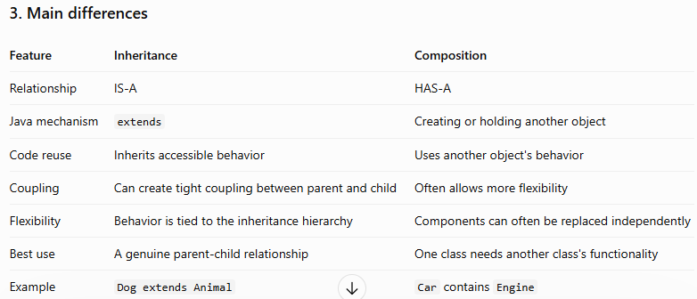

 4. Why is composition often preferred?
Consider a real project.

Suppose you create an OrderService that needs to send notifications.
Poor design: Inheritance
class EmailNotification {

    void sendEmail() {
        System.out.println("Email sent");
    }
}

class OrderService extends EmailNotification {

    void placeOrder() {
        sendEmail();
    }
}

The problem is that an OrderService is not an EmailNotification. It only needs to use notification functionality.

Inheritance creates an incorrect relationship.
Better design: Composition
interface NotificationService {
    void send();
}

class EmailNotificationService
        implements NotificationService {

    public void send() {
        System.out.println("Email sent");
    }
}

class OrderService {

    private final NotificationService notificationService;

    OrderService(NotificationService notificationService) {
        this.notificationService = notificationService;
    }

    void placeOrder() {
        // Order processing logic
        notificationService.send();
    }
}

Now OrderService uses a NotificationService instead of extending an email class.

Benefits:
- You can replace email notifications with another implementation.
- You can test OrderService using a mock notification service.
- Order logic and notification logic remain separate.
- Changes to the notification implementation require fewer changes to the order service.
In Spring Boot, dependency injection can provide the required NotificationService implementation. If multiple implementations exist, you can select one using @Qualifier, @Primary, or suitable routing logic.
5. When should you use each?
Use inheritance when a genuine IS-A relationship exists.

Example: Dog extends Animal.

Use composition when a class needs another object's functionality.

Example: OrderService uses NotificationService.

Composition is often preferable for business services because it allows dependencies to change independently. However, inheritance is still appropriate when the parent-child relationship is meaningful and stable.
6. Interview-ready answer
You can remember and say:
Inheritance represents an IS-A relationship, where a child class inherits accessible behavior from a parent class using extends. Composition represents a HAS-A relationship, where one class contains or uses another object. For example, a Dog extends Animal, while an OrderService uses a NotificationService. In enterprise applications, I often prefer composition because it reduces coupling, improves testability, and makes implementations easier to replace. I use inheritance when a genuine and stable parent-child relationship exists.

Quick memory trick
Inheritance → IS-A → Dog IS an Animal.

Composition → HAS-A → Car HAS an Engine.
=========================================================================================================================
17. What is the difference between Association, Aggregation, and Composition?
First, remember these three simple meanings:
- Association = Uses or works with
- Aggregation = HAS-A, but both objects can exist independently
- Composition = HAS-A, with strong ownership of the parts
All three describe relationships between objects in Java.
1. Association — objects work with each other
Simple meaning
Association means one object communicates with or uses another object. It does not necessarily own the other object.

Real-life example: A teacher teaches a student. The teacher and student can exist independently.
Java example
class Student {
    String name;
}

class Teacher {

    void teach(Student student) {
        System.out.println("Teacher is teaching the student");
    }
}

Usage:
Student student = new Student();
Teacher teacher = new Teacher();

teacher.teach(student);

How does it work?
- Teacher uses a Student object.
- Teacher does not own the student's lifecycle.
- Both objects can exist independently.
Remember: Association = One object interacts with another.
2. Aggregation — a weak HAS-A relationship
Simple meaning
Aggregation means one object contains or groups other objects, but those objects can still exist independently.

Real-life example: A department has professors. If a department closes, its professors can still exist and work elsewhere.
Java example
import java.util.List;

class Professor {
    String name;

    Professor(String name) {
        this.name = name;
    }
}

class Department {

    private List<Professor> professors;

    Department(List<Professor> professors) {
        this.professors = professors;
    }
}

Usage:
Professor p1 = new Professor("Amit");
Professor p2 = new Professor("Priya");

Department department = new Department(List.of(p1, p2));

How does it work?
- Department groups professor objects.
- Professors are created outside the department.
- The professors can continue to exist even if the department object is no longer used.
Remember: Aggregation = HAS-A, but the parts can exist independently.
3. Composition — a strong HAS-A relationship
Simple meaning
Composition means one object owns its component objects as parts of a whole. Those parts are conceptually dependent on the whole.

Real-life example: A house consists of rooms. In this model, rooms are treated as parts of that particular house, not independent objects that are transferred elsewhere.
Java example
import java.util.ArrayList;
import java.util.List;

class Room {
    Room() {
        System.out.println("Room created");
    }
}

class House {

    private final List<Room> rooms = new ArrayList<>();

    House(int numberOfRooms) {
        for (int i = 0; i < numberOfRooms; i++) {
            rooms.add(new Room());
        }
    }
}

Usage:
House house = new House(3);

How does it work?
- House creates and manages its own rooms.
- The rooms are intended to be parts of that house.
- The design gives House ownership of the room objects.
Remember: Composition = HAS-A, with strong ownership and lifecycle dependency.

One important Java detail: composition is a design relationship, not a rule enforced by the language. Java does not automatically destroy a Room when a House becomes unreachable. The design expresses that the rooms belong to the house.
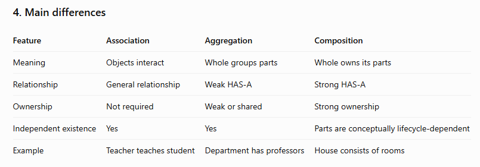

6. Spring Boot production example
Imagine you are building an e-commerce application.
- Association: A Customer interacts with an OrderService to place an order.
- Aggregation: A Department groups Employee objects that can exist independently of that department.
- Composition: An Order owns its OrderItem objects; an order item is considered part of that particular order.
These relationships help developers decide which object should create, manage, or reference another object.

=========================================================================================================================
18. What is an Immutable Class, and How Do You Create One?
First, remember this simple rule:

Immutable class = A class whose object's data cannot be changed after the object is created.
1. Understand with a real-life example
Imagine you have a birth certificate. Once your date of birth is recorded, you cannot simply change it whenever you want.

Similarly, an immutable object does not allow its stored state to be changed after creation.
2. Java example — normal class vs immutable class
A. Normal class (mutable)
class Employee {
    String name;

    Employee(String name) {
        this.name = name;
    }
}

Usage:
Employee emp = new Employee("Rahul");

emp.name = "Amit";

System.out.println(emp.name);

Output:
Amit

Here, we can change the employee's name after creating the object. Therefore, its state is mutable.
B. Immutable class
final class Employee {

    private final String name;

    public Employee(String name) {
        this.name = name;
    }

    public String getName() {
        return name;
    }
}

Usage:
Employee emp = new Employee("Rahul");

System.out.println(emp.getName());

Output:
Rahul

We cannot change name after the object is created. There is no setter, and the field is private final.

For example, this would not compile:
emp.name = "Amit"; // Compilation error

The field is private, so outside code cannot access it directly. It is also final, so it cannot be reassigned after initialization.
3. Rules for creating an immutable class
Remember these five rules:
1. Declare the class final so other classes cannot extend it and add mutable behavior.
2. Make all instance variables private.
3. Make fields final and initialize them when creating the object.
4. Do not provide setter methods.
5. If a field refers to a mutable object, make defensive copies when storing it and when returning it.
The fifth rule is important because final prevents reassignment of a reference, but it does not automatically prevent changes to the referenced object.
4. Real-world Java example
Java's String class is immutable.
String name = "Rahul";

name.concat(" Lakhade");

System.out.println(name);

Output:
Rahul

Why? Because concat() returns a new string instead of changing the existing string. We did not assign that returned string back to name.

To store the changed text:
name = name.concat(" Lakhade");

System.out.println(name);

Output:
Rahul Lakhade

The name variable now refers to the new string. The original string was not modified.
5. Why do we use immutable classes?
- Thread safety: Immutable objects can be shared between threads without their state changing unexpectedly.
- Reliability: Their data cannot be modified accidentally.
- Simpler debugging: Once created, their state remains stable.
- Safe sharing: Immutable objects are useful for values such as dates, identifiers, and configuration settings.
=========================================================================================================================
19. How would you design a thread-safe immutable class in Java?
First, remember this simple rule:
- Immutable = Object data cannot change after creation.
- Thread-safe = Multiple threads can use an object safely without causing incorrect results.
A properly designed immutable object is generally thread-safe because its state cannot be changed after construction.
1. Understand with a real-life example
Imagine an employee profile containing an employee ID, name, and skills.

Multiple threads may read this profile at the same time.

If nobody can change its data after the profile is created, the threads won't interfere with each other by modifying that shared state.
2. Java example
Let's create an immutable EmployeeProfile class.
import java.util.List;

public final class EmployeeProfile {

    private final int employeeId;
    private final String name;
    private final List<String> skills;

    public EmployeeProfile(
            int employeeId,
            String name,
            List<String> skills) {

        this.employeeId = employeeId;
        this.name = name;

        // Make a defensive copy
        this.skills = List.copyOf(skills);
    }

    public int getEmployeeId() {
        return employeeId;
    }

    public String getName() {
        return name;
    }

    public List<String> getSkills() {
        return skills;
    }
}

How do we use it?
import java.util.ArrayList;
import java.util.List;

public class Main {

    public static void main(String[] args) {

        List<String> skills = new ArrayList<>();
        skills.add("Java");
        skills.add("Spring Boot");

        EmployeeProfile employee =
                new EmployeeProfile(101, "Rahul", skills);

        // Changing the original list does not change the profile
        skills.add("Docker");

        System.out.println(employee.getSkills());
    }
}

Output:
[Java, Spring Boot]

Why doesn't Docker appear? Because the constructor copied the skills into an unmodifiable list.

Also, trying to modify the list returned by getSkills() will throw UnsupportedOperationException.
3. Rules for designing a thread-safe immutable class

1. Make the class final

This prevents subclasses from adding behavior that could break the intended immutability.

2. Make fields private final

Initialize fields in the constructor and don't reassign them later.

3. Use defensive copying

Copy mutable inputs, such as lists and dates, so outside code cannot change the object's internal state.

4. Don't expose mutable internal data

Return immutable collections or defensive copies instead of returning internal mutable objects.

5. Don't let this escape during construction

Avoid publishing the object or calling overridable methods before initialization is complete.

4. Important interview point: Is final enough?
No. Consider this example:
private final List<String> skills;

The reference cannot be reassigned, but the list itself might still be mutable. Someone could add or remove elements if they had access to that list.

That's why we use:
this.skills = List.copyOf(skills);

Important: List.copyOf() makes an unmodifiable copy of the list structure. If the list contains mutable objects, those objects may still change. For complete immutability, the contained objects must also be immutable or defensively copied.
5. How does this help in a Spring Boot application?
Suppose multiple request-handling threads read the same application configuration or employee profile.

An immutable object can be safely shared because those threads cannot change its state. This reduces synchronization requirements and avoids many common concurrency bugs.

However, if a class has mutable shared state, merely declaring its fields final does not make it thread-safe. You may need synchronization, locks, or concurrent data structures.
6. Interview-ready answer
I would design a thread-safe immutable class by declaring the class final, making its fields private and final, initializing them through the constructor, and avoiding setter methods. I would also use defensive copies for mutable objects and would not expose internal mutable state. For example, I can use List.copyOf() for a list of immutable values. Since the object's state cannot change after construction, multiple threads can safely read it without synchronization for those reads. I would also ensure the object is safely published to other threads.

Quick memory trick
Final class + private final fields + defensive copies + no setters + safe publication.
=========================================================================================================================
20. What is the difference between Shallow Copy and Deep Copy in Java?
First, remember this simple rule:
- Shallow Copy = Copies the object, but shares references to nested objects.
- Deep Copy = Copies the object and creates separate copies of its nested mutable objects.
Let's understand this step by step.
1. Understand with a real-life example
Imagine you have an employee record containing an employee name and an address.
- Shallow copy: You create a second employee record, but both records point to the same address object.
- Deep copy: You create a second employee record and a separate address object for it.
Shallow copy
Employee 1

Shared Address object

Employee 2
Both employee objects refer to the same address.

Deep copy
Employee 1
Address 1

Employee 2
Address 2

Each employee has a separate address object.

2. Shallow copy in Java
Let's create two classes: Address and Employee.
class Address {
    String city;

    Address(String city) {
        this.city = city;
    }
}

class Employee {
    String name;
    Address address;

    Employee(String name, Address address) {
        this.name = name;
        this.address = address;
    }
}

Now create a shallow copy:
Address address = new Address("Pune");

Employee emp1 = new Employee("Rahul", address);

// Shallow copy
Employee emp2 = new Employee(emp1.name, emp1.address);

emp2.address.city = "Mumbai";

System.out.println(emp1.address.city);
System.out.println(emp2.address.city);

Output:
Mumbai
Mumbai

Why did both cities change?
1. emp1 has an address object.
2. emp2 receives the same address reference.
3. Both employees point to the same Address object.
4. Changing the city through emp2 also affects what we see through emp1.
This is a shallow copy: the employee objects are different, but their nested address reference is shared.
3. Deep copy in Java
Now let's copy the address object as well.

Using the same Address and Employee classes:
Address address = new Address("Pune");

Employee emp1 = new Employee("Rahul", address);

// Deep copy
Employee emp2 = new Employee(
    emp1.name,
    new Address(emp1.address.city)
);

emp2.address.city = "Mumbai";

System.out.println(emp1.address.city);
System.out.println(emp2.address.city);

Output:
Pune
Mumbai

Why are the results different?
1. emp1 has its own address object.
2. emp2 receives a newly created address object.
3. Changing emp2.address.city does not affect emp1.
This is a deep copy for this example because we copied the mutable nested Address object instead of sharing it.
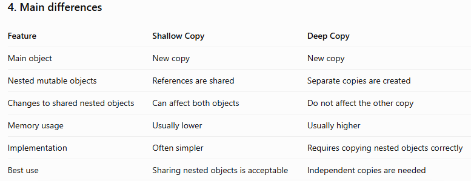

Important: Java's Object.clone() conventionally produces a shallow copy unless you explicitly implement deeper copying. Also, primitive fields are copied by value, and immutable objects such as String can safely be shared.
5. Real-world Spring Boot example
Imagine your application processes employee data from a request.
- Shallow copy: You copy an employee object but share its mutable address object. Updating the copied employee's address could unexpectedly affect the original object.
- Deep copy: You create separate copies of the employee and its mutable address data. Changes to one copy do not affect the other.
Deep copies are useful when you need independent snapshots or want to prevent accidental modification of shared mutable data. However, copying the entire object graph can be expensive, so copy only what your use case requires.
6. Interview-ready answer
You can remember and say:
Shallow copy creates a new object but shares references to nested objects. Deep copy creates a new object and separate copies of its nested mutable objects. For example, if two employee objects share the same address object in a shallow copy, changing the address through one employee affects the other. In a deep copy, each employee has a separate address, so the change does not affect the original. Shallow copying is simpler and often uses less memory, while deep copying provides greater independence between objects.

Quick memory trick
Shallow Copy → Different outer objects, shared nested references.

Deep Copy → Different outer objects, separate nested mutable objects.
=========================================================================================================================
21. Why is String Immutable in Java?
First, remember this simple rule:

String is immutable = Once a String object is created, its value cannot be changed.

If you perform an operation that appears to modify a string, Java creates a new String object instead of changing the existing one.
1. Understand with a simple example
Imagine you write your name on a piece of paper. Instead of erasing the original paper, you write the changed name on a new piece of paper.

Java String works similarly.
Java example
String name = "Rahul";

name.concat(" Lakhade");

System.out.println(name);

Output:
Rahul

Why didn't the name change?
1. name refers to the String object "Rahul".
2. concat(" Lakhade") creates and returns a new String.
3. We did not store that returned String.
4. Therefore, name still refers to "Rahul".
To store the changed value:
String name = "Rahul";

name = name.concat(" Lakhade");

System.out.println(name);

Output:
Rahul Lakhade

Here, name refers to the new String object. The original "Rahul" String was not modified.
2. Why is String immutable?
Java keeps String immutable for several important reasons.
1. Security
Strings are commonly used for sensitive or important values, such as file paths, URLs, usernames, and configuration values.

If a String could be changed unexpectedly by other code, it could create security problems.
2. String Constant Pool
Java can reuse String literals from a shared area called the String Constant Pool.
String s1 = "Java";
String s2 = "Java";

System.out.println(s1 == s2);

Output:
true

Both variables refer to the same pooled String object. Because its value cannot be changed, sharing that object is safe.
3. Thread safety
Multiple threads can read the same immutable String without worrying that another thread will modify its characters.

This makes Strings useful in multithreaded applications.
4. Reliable hash codes
Strings are commonly used as keys in HashMap.
Map<String, Integer> map = new HashMap<>();

map.put("Java", 100);

System.out.println(map.get("Java"));

Output:
100

Because a String's value cannot change, its equality and hash code remain consistent. This helps the map find the correct entry.
5. Performance and reuse
Since Strings cannot change, Java can safely reuse them in suitable situations, including through the String Constant Pool. Java can also cache a String's hash code.
3. What happens when we concatenate Strings?
String s1 = "Hello";
String s2 = s1.concat(" World");

System.out.println(s1);
System.out.println(s2);

Output:
Hello
Hello World

- s1 still refers to "Hello".
- s2 refers to the new String "Hello World".
Important: Immutability means the String object's contents cannot change. A variable holding a String reference can still be reassigned to another String..
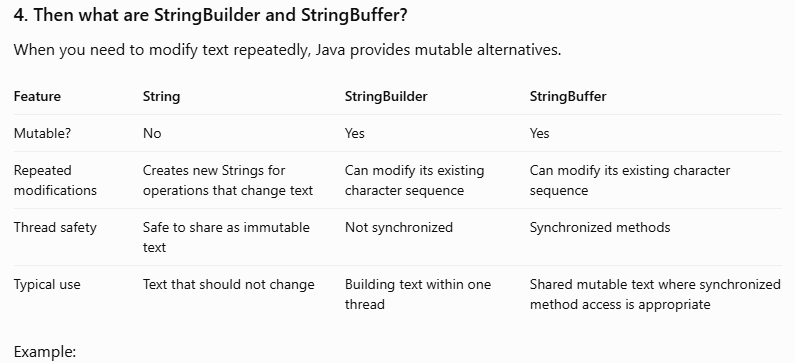
Example:
StringBuilder text = new StringBuilder("Hello");

text.append(" World");

System.out.println(text);

Output:
Hello World

Here, StringBuilder modifies its own character sequence rather than creating a new String for each append.
5. Interview-ready answer
You can remember and say:
String is immutable in Java, which means its value cannot be changed after the object is created. Any operation such as concatenation creates a new String rather than modifying the existing one. Immutability helps with security, safe sharing between threads, String Constant Pool reuse, and reliable hash codes when Strings are used as map keys. When repeated string modifications are required, I use StringBuilder, which is mutable and generally more efficient for building text in a single thread.

Quick memory trick
String → Immutable → Cannot change its contents.

StringBuilder → Mutable → Efficient for building text.

StringBuffer → Mutable → Synchronized methods.
=========================================================================================================================
22. What is the String Constant Pool in Java?
First, remember this simple rule:

String Constant Pool = A special area where Java stores and reuses String objects to save memory.

Let's understand this step by step.
1. Understand with a simple example
Imagine you and your friend both need a book named Java.

Instead of buying two identical books, you share the same book.

Java can do something similar with String literals: it reuses the same pooled String object when the same literal is used.
2. Java example — String Constant Pool
public class Main {
    public static void main(String[] args) {

        String s1 = "Java";
        String s2 = "Java";

        System.out.println(s1 == s2);
        System.out.println(s1.equals(s2));
    }
}

Output:
true
true

Why are both results true?
- s1 refers to the pooled String object "Java".
- s2 refers to the same pooled String object.
- == returns true because both references point to the same object.
- equals() returns true because both strings contain the same text.
s1 → "Java"

s2 → "Java"

String Constant Pool

One shared "Java" object

3. What happens when we use new String()?
Now look at this example:
String s1 = "Java";
String s2 = new String("Java");

System.out.println(s1 == s2);
System.out.println(s1.equals(s2));

Output:
false
true

Why?
- s1 refers to the pooled String object.
- new String("Java") explicitly creates a distinct String object for s2.
- == returns false because the two references point to different objects.
- equals() returns true because their contents are equal.
Remember: == checks object identity for references; equals() checks content equality for String objects.
4. What is the purpose of the String Constant Pool?
The main purpose is to reuse String objects and reduce unnecessary memory usage.

For example:
String s1 = "Spring";
String s2 = "Spring";
String s3 = "Spring";

These variables can all refer to the same pooled String object instead of requiring three separate String objects.

This is safe because String objects are immutable: their contents cannot be changed after creation.
5. What does intern() do?
The intern() method returns the canonical String associated with that text in the String pool.
String s1 = "Java";

String s2 = new String("Java");

String s3 = s2.intern();

System.out.println(s1 == s2);
System.out.println(s1 == s3);

Output:
false
true

How does it work?
- s1 refers to the pooled "Java" object.
- s2 refers to a separate object created using new.
- s2.intern() returns the pooled canonical String for "Java".
- Therefore, s1 == s3 returns true.
6. Interview-ready answer
The String Constant Pool is a special area used by Java to store and reuse canonical String objects. When the same String literal is used multiple times, Java can make multiple references point to the same pooled object, which helps reduce memory usage. For example, String s1 = "Java" and String s2 = "Java" normally refer to the same pooled object, so s1 == s2 returns true. However, new String("Java") creates a distinct object. The intern() method returns the canonical pooled String for the same content.

Quick memory trick
String literal → Can reuse the pooled object.

new String() → Creates a distinct object.

intern() → Returns the canonical pooled String.
=========================================================================================================================
23. What is the difference between == and equals() for Strings?
First, remember this simple rule:
- == → Checks whether two references point to the same object.
- equals() → Checks whether two Strings contain the same text.
1. Using == with Strings
Simple Java example
String s1 = new String("Java");
String s2 = new String("Java");

System.out.println(s1 == s2);

Output:
false

Why?
- s1 refers to one String object.
- s2 refers to another String object.
- Both contain "Java", but they are different objects.
- Therefore, == returns false.
Remember: For object references, == checks object identity, not String content.
2. Using equals() with Strings
Now, look at the same example using equals().
String s1 = new String("Java");
String s2 = new String("Java");

System.out.println(s1.equals(s2));

Output:
true

Why?

Both String objects contain the same text, "Java". The String class overrides equals() to compare the contents of the strings.

Remember: equals() checks String content.
3. Important example — String Constant Pool
String s1 = "Java";
String s2 = "Java";

System.out.println(s1 == s2);
System.out.println(s1.equals(s2));

Output:
true
true

Why is == also true here?

Java reuses the same pooled String object for identical String literals in this example. Therefore, both references point to the same object.
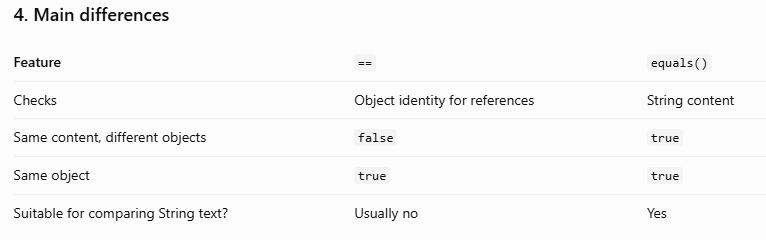
5. Real-world Spring Boot example
Suppose you are checking a status received from an API.
String status = new String("SUCCESS");

if (status.equals("SUCCESS")) {
    System.out.println("Operation completed");
}

Output:
Operation completed

Use equals() to compare the text because the status String may come from a request, database, or external service and may not be the same object as the literal.

If the String could be null, use a null-safe comparison:
if ("SUCCESS".equals(status)) {
    System.out.println("Operation completed");
}

This avoids a NullPointerException if status is null.
6. Interview-ready answer
In Java, == compares object references to determine whether they refer to the same object, whereas equals() compares String contents. For example, two Strings created using new String("Java") produce false with == but true with equals(). However, identical String literals can refer to the same pooled object, making == true. In business logic, I generally use equals() for comparing String values.

Quick memory trick
== → Same object?

equals() → Same text?
=========================================================================================================================
24. What is the difference between String, StringBuilder, and StringBuffer?
First, remember this simple rule:
- String → Immutable; its contents cannot be changed.
- StringBuilder → Mutable; you can modify the text.
- StringBuffer → Mutable; its methods are synchronized for thread safety.
All three are used to work with text in Java, but they behave differently.
1. String — Immutable
Simple meaning
Once a String object is created, its contents cannot be changed. If you perform an operation that changes the text, Java returns a new String instead.
Java example
String text = "Hello";

text.concat(" Java");

System.out.println(text);

Output:
Hello

Why?
1. text refers to "Hello".
2. concat(" Java") returns a new String containing "Hello Java".
3. We did not assign the returned String to text.
4. Therefore, text still contains "Hello".
To store the new value:
String text = "Hello";

text = text.concat(" Java");

System.out.println(text);

Output:
Hello Java

Remember: String is best when you want to represent text that should not be modified in place.
2. StringBuilder — Mutable
Simple meaning
StringBuilder lets you modify the same builder object by appending, inserting, deleting, or replacing characters.
Java example
StringBuilder text = new StringBuilder("Hello");

text.append(" Java");

System.out.println(text);

Output:
Hello Java

How does it work?
- StringBuilder starts with "Hello".
- append() adds " Java" to its character sequence.
- The existing builder is modified, and no new StringBuilder is required for this append operation.
When should we use it?
Suppose you are constructing a message inside a loop:
StringBuilder result = new StringBuilder();

for (int i = 1; i <= 3; i++) {
    result.append(i).append(" ");
}

System.out.println(result);

Output:
1 2 3

StringBuilder is generally a good choice for repeated text modifications within a single thread.
3. StringBuffer — Mutable and synchronized
Simple meaning
StringBuffer is similar to StringBuilder, but its methods are synchronized to coordinate access between threads.
Java example
StringBuffer text = new StringBuffer("Hello");

text.append(" Java");

System.out.println(text);

Output:
Hello Java

The basic usage looks like StringBuilder.

The key difference is that StringBuffer synchronizes its methods, which can help when multiple threads access the same buffer.

Important: Synchronization of individual methods does not automatically make a sequence of multiple operations atomic. You may still need additional synchronization for multi-step logic.
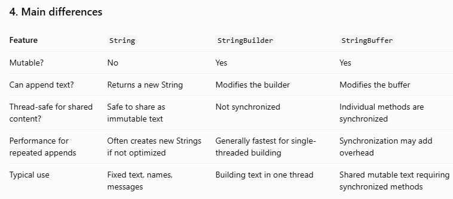
5. Real-world Spring Boot example
Imagine you need to create a report containing many employee names.

Using String: Repeated concatenations can create many intermediate String objects.

Using StringBuilder: Build the report efficiently within the request-handling thread.

Using StringBuffer: Consider it when a mutable text buffer is shared between threads and synchronized method access is appropriate. In most Spring Boot request-handling code, a local StringBuilder is simpler because each request can have its own builder.

For example:
StringBuilder report = new StringBuilder();

report.append("Employee Report\n");
report.append("Name: Rahul\n");
report.append("Department: IT\n");

System.out.println(report);

6. Interview-ready answer
You can remember and say:
String, StringBuilder, and StringBuffer are used to handle text in Java. String is immutable, so operations that change its contents return a new String. StringBuilder is mutable and is generally preferred for repeated string modifications in a single thread because its methods are not synchronized. StringBuffer is also mutable, but its methods are synchronized for thread safety. In my applications, I generally use String for fixed text and StringBuilder when constructing strings repeatedly.

Quick memory trick
String → Immutable

StringBuilder → Mutable, usually preferred for single-threaded text building

StringBuffer → Mutable, synchronized methods
=========================================================================================================================
25. What does the intern() method do in Java?
First, remember this simple rule:

intern() returns the canonical String from the String Constant Pool for the same text.

It helps Java reuse a String object instead of keeping multiple equivalent String objects when appropriate.
1. Simple Java example
String s1 = "Java";

String s2 = new String("Java");

String s3 = s2.intern();

System.out.println(s1 == s2);
System.out.println(s1 == s3);

Output:
false
true

Why does this happen?
Step 1: Create a String literal.
String s1 = "Java";

s1 refers to the pooled "Java" String.

Step 2: Create a separate String object.
String s2 = new String("Java");

s2 refers to a different object containing the same text.

Step 3: Call intern().
String s3 = s2.intern();

Java returns the canonical pooled String for "Java". Since s1 already refers to that object, s1 and s3 refer to the same object.

Therefore:
- s1 == s2 → false, because they reference different objects.
- s1 == s3 → true, because they reference the same object.
2. Visual understanding
s1 → "Java"

Pooled String object

s2 → "Java"

Separate String object

s3 = s2.intern()

Returns the pooled "Java" object

3. What if the String is not already in the pool?
If the pool does not yet contain an equal String, intern() adds a canonical representation and returns its reference. If an equal String is already pooled, it returns the existing pooled reference.

For example:
String text = new String(
    new char[]{'C', 'o', 'd', 'e'}
);

String pooled = text.intern();

System.out.println(pooled);

Output:
Code

The method returns a String reference. It does not modify the original String object.
4. Why do we use intern()?
It can help reduce duplicate String storage when an application handles many repeated text values.

For example, an application may process thousands of records containing repeated category names such as "ACTIVE", "INACTIVE", and "PENDING".

However, do not use intern() everywhere. Pooling large numbers of unique strings can add overhead and memory pressure. Use it only when measurements show that sharing repeated strings is beneficial.
5. Interview-ready answer
The intern() method in Java returns the canonical String from the String Constant Pool for a given string value. If an equal String is already pooled, it returns that reference; otherwise, it adds a canonical representation and returns its reference. For example, String s1 = "Java" and String s2 = new String("Java") refer to different objects, but s2.intern() returns the pooled String, making s1 == s2.intern() true. It can help reuse repeated strings, but should be used selectively.

Quick memory trick
intern() → Get the canonical pooled String.

== → Check whether references point to the same object.

equals() → Check whether String contents are equal.
=========================================================================================================================
26. What is the output of String s = new String("Java")? How many objects may be created?
Remember: Usually, the interview answer is 2 String objects, assuming "Java" is not already present in the String Constant Pool.
1. Java example
String s = new String("Java");

System.out.println(s);

Output:
Java

2. How many objects are created?
Let's understand step by step.
String s = new String("Java");

Object 1: String Constant Pool

The literal "Java" refers to a canonical String in the String Constant Pool. If an equal String is not already in the pool, Java creates one for it.

Object 2: A new String object

The new String("Java") expression explicitly creates a separate String object.

Conceptually:
String Constant Pool

"Java" — pooled String

new String("Java") creates a separate object

Separate String object

s points here

3. Important interview trap
If "Java" is already present in the String Constant Pool, the literal reuses the existing pooled String. The statement creates only one new String object through new String(...).
Situation	New String objects created by this statement
"Java" is not already pooled	2
"Java" is already pooled	1
4. Interview-ready answer
The statement String s = new String("Java") usually creates two String objects if the literal "Java" is not already present in the String Constant Pool: one pooled String and one separate object created by the new keyword. If the literal is already pooled, only one additional String object is created. Printing s displays Java.

Memory trick: String literal → pooled object; new String() → separate object.
=========================================================================================================================
27. What happens when you concatenate Strings using the + operator?
First, remember this simple rule:

String concatenation joins text together. Because String is immutable, the result is a new String value.
1. Simple Java example
String s1 = "Hello";
String s2 = "Java";

String result = s1 + " " + s2;

System.out.println(result);

Output:
Hello Java

How does it work?
1. Java takes the value of s1: "Hello".
2. It joins a space and the value of s2: "Java".
3. The expression produces the String "Hello Java".
4. result refers to the resulting String.
The original Strings s1 and s2 remain unchanged.
2. What happens to the objects?
String s1 = "Java";
String s2 = s1 + " Programming";

System.out.println(s1);
System.out.println(s2);
System.out.println(s1 == s2);

Output:
Java
Java Programming
false

The original s1 still refers to "Java". The concatenation produces a different String value, which s2 refers to.

Important: The exact number of objects created by concatenation depends on the expression, compiler optimizations, and whether a resulting String already exists. Do not assume every + operation always creates exactly one new object.
3. What happens when we concatenate String literals?
String s1 = "Hello" + "Java";
String s2 = "HelloJava";

System.out.println(s1 == s2);

Output:
true

Because both expressions are compile-time constants, Java can combine them during compilation. Both references can point to the same pooled String, "HelloJava".
4. What happens when we concatenate variables?
String a = "Hello";
String b = "Java";

String s1 = a + b;
String s2 = "HelloJava";

System.out.println(s1.equals(s2));
System.out.println(s1 == s2);

Output:
true
false

The contents are equal, but you should not rely on == to compare the resulting strings' contents.

Use equals() for String content comparison.
5. What happens internally?
Conceptually, Java must combine the text values to produce the result.

Depending on the Java version and expression, the compiler may use StringBuilder or the invokedynamic mechanism with StringConcatFactory to implement concatenation. The implementation is optimized by the compiler and JVM.

You generally do not need to create a StringBuilder manually for a simple expression such as:
String message = firstName + " " + lastName;

However, for repeated concatenation inside a loop, StringBuilder is generally a better choice.
StringBuilder result = new StringBuilder();

for (int i = 1; i <= 3; i++) {
    result.append(i).append(" ");
}

System.out.println(result);

Output:
1 2 3

6. Interview-ready answer
The + operator concatenates Strings and produces the combined text as a String result. Since Strings are immutable, the original String objects are not modified. Compile-time constant concatenations can be evaluated during compilation and may reuse the String Constant Pool. For repeated concatenation in a loop, I generally prefer StringBuilder to avoid unnecessary intermediate Strings.

Quick memory trick
- + → Joins Strings
- String → Immutable
- equals() → Compares text
- StringBuilder → Useful for repeated concatenation
=========================================================================================================================

28. How does String concatenation inside a loop affect performance?
First, remember this simple rule:

Repeated String concatenation inside a loop can be slow because String is immutable. Use StringBuilder when building text repeatedly.

Let's understand step by step.
1. Using String concatenation inside a loop
Consider this Java program:
String result = "";

for (int i = 1; i <= 5; i++) {
    result = result + i;
}

System.out.println(result);

Output:
12345

What happens internally?
Because String is immutable, each concatenation produces a new String result. The existing text must be copied into the new result along with the additional character or text.
Iteration 1
""

"1"

"1"

Iteration 2
"1"

"2"

"12"

Iteration 3
"12"

"3"

"123"

Every iteration copies the accumulated text into the new result. The example is simplified to show the main idea.

As the result becomes longer, more characters may need to be copied in every iteration.
2. Why can this become slow?
Suppose you concatenate 10,000 pieces of text.

With repeated concatenation, the program may repeatedly copy the text accumulated so far. For a growing string, the total amount of copying can grow approximately quadratically, or O(n²), where n is the number of appended pieces.

That can lead to:
- More temporary String objects.
- More memory allocation.
- More work for the garbage collector.
- Slower execution as the loop grows.
The exact performance depends on the Java version, compiler optimizations, and the workload, but repeated concatenation is generally worth avoiding when the accumulated result grows substantially.
3. Better approach — use StringBuilder
StringBuilder result = new StringBuilder();

for (int i = 1; i <= 5; i++) {
    result.append(i);
}

System.out.println(result);

Output:
12345

Why is this better?
StringBuilder is mutable, so it can append text to its existing character sequence instead of creating a new String for every iteration.

For typical repeated appends, building a string this way takes approximately O(n) time overall, assuming the appended text has a total length proportional to n.

To get the final String, call:
String finalResult = result.toString();

4. Comparison
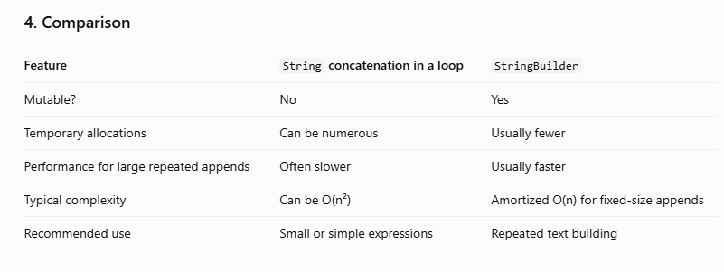
5. Real-world Spring Boot example
Imagine a Spring Boot service generates a report containing thousands of employee names.

Using String concatenation repeatedly inside a loop may create many intermediate results, wasting CPU and memory.

Instead:
StringBuilder report = new StringBuilder();

for (String employeeName : employeeNames) {
    report.append(employeeName).append("\n");
}

return report.toString();

This is generally more efficient for building a large report.

Senior-level tip: Don't optimize every + operator blindly. A simple expression such as firstName + " " + lastName is fine. Use StringBuilder when repeatedly accumulating text, and benchmark performance-sensitive code when the difference matters.
6. Interview-ready answer
String concatenation inside a loop can negatively affect performance because String is immutable. Each concatenation produces a new String result, potentially copying the previously accumulated text and creating temporary objects. For a growing result, the total copying can become approximately O(n²). I generally use StringBuilder for repeated concatenation because it modifies an existing character sequence and typically provides amortized O(n) performance for repeated appends. This reduces unnecessary allocations and improves performance.

Quick memory trick
String + loop → Potentially more allocations and copying.

StringBuilder + loop → Usually better for repeated appends.
=========================================================================================================================
29. Can you create your own immutable class containing a mutable object?
Yes! You can create an immutable class containing a mutable object, but you must prevent outside code from changing the internal object's state.

Remember this simple rule:
- Mutable object: Its data can change after creation.
- Immutable class: Its internal state cannot be changed after creation.
- Defensive copy: Create a separate copy to protect the original data.
1. Understand with a simple example
Imagine an immutable Employee class contains a Date object representing the employee's joining date.

The problem is that Java's Date class is mutable. Someone could change the date after the employee object is created.
2. Incorrect approach — final is not enough
import java.util.Date;

final class Employee {

    private final Date joiningDate;

    Employee(Date joiningDate) {
        this.joiningDate = joiningDate;
    }

    public Date getJoiningDate() {
        return joiningDate;
    }
}

Look at this code:
Date date = new Date();

Employee employee = new Employee(date);

// Change the original Date object
date.setTime(0);

// The Employee's date also changes!
System.out.println(employee.getJoiningDate());

Why is this a problem?

The constructor stores the original Date reference, and the getter returns that same reference. External code can therefore change the date inside the supposedly immutable object.

Declaring the field final prevents reassignment of the reference; it does not make the referenced Date immutable.
3. Correct approach — use defensive copying
We must copy the mutable object in two places:
1. Inside the constructor: Copy the input so external code cannot modify our internal date.
2. Inside the getter: Return a copy so external code cannot modify our internal date through the getter.
import java.util.Date;

public final class Employee {

    private final Date joiningDate;

    public Employee(Date joiningDate) {
        this.joiningDate = new Date(
            joiningDate.getTime()
        );
    }

    public Date getJoiningDate() {
        return new Date(
            joiningDate.getTime()
        );
    }
}

Test the class
Date date = new Date(1000000L);

Employee employee = new Employee(date);

// Modify the original Date
date.setTime(0);

System.out.println(
    employee.getJoiningDate().getTime()
);

Output:
1000000

The original employee date remains unchanged because the constructor made a copy.

Now let's try modifying the object returned by the getter:
Date returnedDate = employee.getJoiningDate();

returnedDate.setTime(0);

System.out.println(
    employee.getJoiningDate().getTime()
);

Output:
1000000

Again, the internal date remains unchanged because the getter returned a separate copy.
4. Rules to remember
To make an immutable class that contains mutable objects:
1. Declare the class final.
2. Make fields private final.
3. Initialize the fields through the constructor.
4. Make defensive copies of mutable input objects.
5. Return defensive copies instead of exposing internal mutable objects.
6. Do not provide setters or other methods that modify the internal state.
These rules protect the class's state, provided mutable nested objects are also handled correctly.
5. Interview-ready answer
Yes, we can create an immutable class that contains mutable objects. However, making the reference final is not sufficient because the referenced object can still be modified. To maintain immutability, I use defensive copying in both the constructor and the getter. For example, if my Employee class contains a mutable Date object, I create a copy of the incoming Date and return a new copy from the getter. This prevents external code from modifying the internal state.

Quick memory trick
Mutable field + defensive copy in constructor + defensive copy in getter = Protected immutable state.
=========================================================================================================================
30. Why is String commonly used for keys in a HashMap?
First, remember this simple rule:

String is commonly used as a HashMap key because it is immutable, has consistent hashCode() and equals() behavior, and is convenient for representing identifiers such as names, usernames, and codes.

Let's understand this step by step.
1. What is a HashMap?
A HashMap stores data as key-value pairs.

For example, an employee ID can be the key, and an employee name can be the value.
import java.util.HashMap;
import java.util.Map;

public class Main {
    public static void main(String[] args) {
        Map<String, String> employees = new HashMap<>();

        employees.put("E101", "Rahul");
        employees.put("E102", "Priya");

        System.out.println(employees.get("E101"));
    }
}

Output:
Rahul

Here:
- "E101" is the key.
- "Rahul" is the value.
- get("E101") retrieves the value associated with that key.
2. Why is String a good key?
Reason 1: String is immutable
Once a String object is created, its content cannot be changed.
String key = "Java";

key.concat(" Spring");

System.out.println(key);

Output:
Java

The original String remains unchanged. concat() returns a new String.

Why does this matter?

A HashMap uses a key's hashCode() to help locate its entry. If a key's hash-related state changes after insertion, retrieving the entry can become unreliable.

Because a String's content cannot change, its hash code remains consistent.
Reason 2: String overrides equals() and hashCode()
Java's String class provides implementations of both methods.
Map<String, String> map = new HashMap<>();

map.put(new String("Java"), "Developer");

System.out.println(map.get(new String("Java")));

Output:
Developer

Although the two String objects are different objects, their contents are equal.

The HashMap uses their hash codes to locate a candidate entry and equals() to determine whether the keys match.

This is why a new String containing "Java" can retrieve the value stored using another String containing "Java".
Reason 3: Strings are convenient for identifiers
Strings are commonly used to represent:
- Usernames
- Email addresses
- Product codes
- Country codes
- Status values
- Configuration keys
For example:
Map<String, Integer> stock = new HashMap<>();

stock.put("LAPTOP", 25);
stock.put("MOBILE", 50);

System.out.println(stock.get("LAPTOP"));

Output:
25

3. What happens if we use a mutable object as a key?
Consider a mutable key class:
import java.util.HashMap;
import java.util.Map;

class EmployeeKey {
    int id;

    EmployeeKey(int id) {
        this.id = id;
    }

    @Override
    public int hashCode() {
        return Integer.hashCode(id);
    }

    @Override
    public boolean equals(Object obj) {
        if (this == obj) return true;
        if (!(obj instanceof EmployeeKey)) return false;

        EmployeeKey other = (EmployeeKey) obj;
        return id == other.id;
    }
}

Now use it as a key:
Map<EmployeeKey, String> map = new HashMap<>();

EmployeeKey key = new EmployeeKey(101);
map.put(key, "Rahul");

key.id = 202;

System.out.println(map.get(key));

Output:
null

Why?
1. The key was inserted when its ID was 101.
2. Its hash code was based on 101.
3. We changed the ID to 202.
4. A lookup now uses the new hash code, which may direct the lookup to a different bucket.
5. The entry can no longer be found through the normal lookup.
This demonstrates why a key's fields used by equals() and hashCode() should not change while the key is in the map.
4. Main points to remember
Reason	Benefit
Immutability	Key content cannot change
Consistent hashCode()	Helps locate the correct bucket
Content-based equals()	Equal String keys can retrieve the same entry
Convenient text values	Useful for names, codes, and identifiers
Important: String is not the only suitable HashMap key. Immutable types such as Integer, Long, enums, and properly designed immutable custom classes can also work well.
5. Interview-ready answer
String is commonly used as a HashMap key because it is immutable and provides consistent implementations of equals() and hashCode(). HashMap uses the hash code to locate a bucket and equals to compare keys. Since a String's content cannot change, its hash code remains consistent, making it a reliable key. Strings are also convenient for identifiers such as usernames, product codes, and status values. However, other immutable types can also be used as keys.

Quick memory trick
String key → Immutable + consistent hashCode() + content-based equals() → Reliable HashMap lookup.
=========================================================================================================================
31. How do you reverse a String without using built-in reverse methods?
Simple answer: Start from the last character of the String and read each character until you reach the first character.

We will solve this without using StringBuilder.reverse() or any other built-in reverse method.
1. Java program — using a for loop
public class Main {
    public static void main(String[] args) {

        String input = "Java";
        String reversed = "";

        for (int i = input.length() - 1; i >= 0; i--) {
            reversed = reversed + input.charAt(i);
        }

        System.out.println("Original: " + input);
        System.out.println("Reversed: " + reversed);
    }
}

Output:
Original: Java
Reversed: avaJ

2. Understand the logic step by step
Our input is:
Java

The character positions are:
Index	Character
0	J
1	a
2	v
3	a
The important line is:
for (int i = input.length() - 1; i >= 0; i--)

- input.length() returns 4.
- input.length() - 1 gives the last index, 3.
- i-- moves backward one position each time.
- The loop stops after processing index 0.
Let's see each iteration:
Iteration	i	Character	reversed
1	3	a	"a"
2	2	v	"av"
3	1	a	"ava"
4	0	J	"avaJ"
The final reversed String is "avaJ".
3. A better approach for larger Strings
Repeatedly concatenating Strings can be inefficient because Strings are immutable. We can use a character array instead.
public class Main {
    public static void main(String[] args) {

        String input = "Java";
        char[] chars = input.toCharArray();

        int left = 0;
        int right = chars.length - 1;

        while (left < right) {
            char temp = chars[left];
            chars[left] = chars[right];
            chars[right] = temp;

            left++;
            right--;
        }

        String reversed = new String(chars);

        System.out.println(reversed);
    }
}

Output:
avaJ

Here, we swap the first and last characters, then the second and second-last characters, until they meet in the middle.

Complexity: Both approaches take \(O(n)\) time in terms of character positions, but the first approach can perform \(O(n^2)\) total character copying due to repeated String concatenation. The character-array approach takes \(O(n)\) time and \(O(n)\) extra space.

Note: These common interview solutions reverse Java char values. Some Unicode characters use multiple char values, so reversing complex Unicode text correctly may require code-point or grapheme-aware handling.
4. Interview-ready answer
I can reverse a String without using built-in reverse methods by starting from the last index and iterating backward to index zero. In each iteration, I append the current character to the result. The time complexity is O(n), although repeated String concatenation can cause O(n²) total copying. For better performance, I can convert the String into a character array and swap characters from both ends.

Quick memory trick
Last index → Move backward → Collect characters → Reversed String.
=========================================================================================================================
32. How do you check whether a String is a palindrome in Java?
First, remember this simple rule:

Palindrome = A word that reads the same forward and backward.

Examples:
- "madam" → Palindrome ✅
- "racecar" → Palindrome ✅
- "hello" → Not a palindrome ❌
- "java" → Not a palindrome ❌
1. Java program using a for loop
We will check the String without using any built-in reverse method.
public class Main {
    public static void main(String[] args) {

        String input = "madam";
        boolean isPalindrome = true;

        for (int i = 0; i < input.length() / 2; i++) {

            if (input.charAt(i) !=
                    input.charAt(input.length() - 1 - i)) {

                isPalindrome = false;
                break;
            }
        }

        if (isPalindrome) {
            System.out.println("Palindrome");
        } else {
            System.out.println("Not a Palindrome");
        }
    }
}

Output:
Palindrome

2. Understand the logic step by step
Our input is:
madam

We compare characters from the beginning and end.
Step	Left character	Right character	Match?
1	m	m	Yes
2	a	a	Yes
3	d	d	Middle character
All compared characters match, so "madam" is a palindrome.
Important lines
input.charAt(i)

Gets the character from the beginning.
input.charAt(input.length() - 1 - i)

Gets the corresponding character from the end.
break;

Stops the loop as soon as a mismatch is found.

We only need to compare half the String because each comparison checks a pair of characters.
3. Try another example
Suppose the input is:
String input = "hello";

The first comparison is:
h != o

The characters do not match, so the program sets isPalindrome to false and stops.

Output:
Not a Palindrome

4. Complexity
- Time complexity: \(O(n)\), where \(n\) is the String length.
- Extra space: \(O(1)\), because we use only a few variables and do not create a reversed String.
5. Interview-ready answer
A palindrome is a String that reads the same forward and backward. I check it by comparing the first character with the last character, the second character with the second-last character, and so on. I iterate only through half of the String. If any pair differs, it is not a palindrome. If all pairs match, it is a palindrome. This approach takes O(n) time and O(1) extra space.

Remember: Compare both ends and move toward the middle.
=========================================================================================================================
34. How do you find the first non-repeated character in a String?
First, remember this simple rule:

First non-repeated character = The first character that appears exactly once in the String.

For example, in "swiss":
- s appears 3 times.
- w appears 1 time.
- i appears 1 time.
The first non-repeated character is w.
1. Java program using HashMap
We will use two steps:
1. Count how many times each character appears.
2. Read the String from left to right and return the first character whose count is 1.
import java.util.HashMap;
import java.util.Map;

public class Main {
    public static void main(String[] args) {

        String input = "swiss";

        Map<Character, Integer> frequency = new HashMap<>();

        // Step 1: Count each character
        for (char ch : input.toCharArray()) {
            frequency.put(
                ch,
                frequency.getOrDefault(ch, 0) + 1
            );
        }

        // Step 2: Find the first non-repeated character
        for (char ch : input.toCharArray()) {
            if (frequency.get(ch) == 1) {
                System.out.println(ch);
                return;
            }
        }

        System.out.println("No non-repeated character found");
    }
}

Output:
w

2. Understand the logic step by step
Our input is:
swiss

Step 1: Count each character
Character	Frequency
s	3
w	1
i	1
The HashMap stores each character and its frequency.
Step 2: Check the original String from left to right
Character	Frequency	Action
s	3	Skip
w	1	Found! Stop
i	1	Not checked because w was already found
Important: We scan the original String again because a HashMap does not guarantee insertion order.

This line checks whether the character appears exactly once:
if (frequency.get(ch) == 1)

And this stops the program once the first matching character is found:
return;

3. What if no character is unique?
For example:
String input = "aabb";

Every character appears twice, so the program prints:
No non-repeated character found

4. Complexity
- Time complexity: \(O(n)\) on average.
- Extra space: \(O(k)\), where \(k\) is the number of distinct characters.
Here, \(n\) is the String length.
5. Interview-ready answer
I find the first non-repeated character using a HashMap. First, I iterate through the String and count the frequency of each character. Then I iterate through the original String from left to right and return the first character whose frequency is one. This approach takes O(n) time on average and preserves the original character order when finding the answer.

Quick memory trick
Count characters → Scan the String again → Find frequency 1 → Stop.
=========================================================================================================================
35. How do you check whether two Strings are anagrams in Java?
First, remember this simple rule:

Anagrams = Two words containing exactly the same characters with the same frequency, but possibly in a different order.

Examples:
- "listen" and "silent" → Anagrams ✅
- "race" and "care" → Anagrams ✅
- "hello" and "world" → Not anagrams ❌
1. Java program using sorting
The easiest way to understand this problem is to sort the characters in both Strings and compare them.
import java.util.Arrays;

public class Main {

    public static void main(String[] args) {

        String s1 = "listen";
        String s2 = "silent";

        // Convert both Strings to lowercase
        s1 = s1.toLowerCase();
        s2 = s2.toLowerCase();

        // Convert Strings into character arrays
        char[] arr1 = s1.toCharArray();
        char[] arr2 = s2.toCharArray();

        // Sort both arrays
        Arrays.sort(arr1);
        Arrays.sort(arr2);

        // Compare sorted arrays
        if (Arrays.equals(arr1, arr2)) {
            System.out.println("Strings are anagrams");
        } else {
            System.out.println("Strings are not anagrams");
        }
    }
}

Output:
Strings are anagrams

2. Understand the logic step by step
Our input is:
listen
silent

Step 1: Convert the Strings into character arrays.
listen → [l, i, s, t, e, n]
silent → [s, i, l, e, n, t]

Step 2: Sort both arrays.
listen → [e, i, l, n, s, t]
silent → [e, i, l, n, s, t]

Step 3: Compare the arrays.
Arrays.equals(arr1, arr2)

Both arrays contain the same characters in the same order after sorting, so the result is true.

Therefore, the Strings are anagrams.
3. What if the Strings have different lengths?
For example:
String s1 = "hello";
String s2 = "world";

After sorting, their character arrays differ, so the program prints:
Strings are not anagrams

A useful optimization is to check the lengths before sorting. If the lengths differ, the Strings cannot be anagrams.
4. Complexity
For Strings of length \(n\):
- Time complexity: \(O(n \log n)\), because sorting takes \(O(n \log n)\).
- Extra space: \(O(n)\) for the character arrays.
5. Interview-ready answer
Two Strings are anagrams if they contain exactly the same characters with the same frequencies, regardless of their order. I can convert both Strings into character arrays, sort the arrays, and compare them using Arrays.equals(). If the arrays match, the Strings are anagrams. This approach takes O(n log n) time. For better performance, I can use a character-frequency counting approach that takes O(n) time when the character set is fixed or counting is otherwise efficient.

Quick memory trick
Convert to arrays → Sort → Compare → Same characters means anagram.
=========================================================================================================================
36. Explain the Java Collections Framework Hierarchy
First, remember this simple rule:

Java Collections Framework = A group of interfaces and classes used to store, manage, and process groups of objects.

For example, in a Spring Boot application, you might use a List to store products, a Set to store unique IDs, or a Map to store employee details using employee IDs as keys.
1. Understand the hierarchy
The framework mainly includes the Collection hierarchy and the separate Map hierarchy.
Iterable

Collection

List

Ordered elements
ArrayList

LinkedList

Vector

Stack*

Set

Unique elements
HashSet

LinkedHashSet

TreeSet

Queue

Processing elements
PriorityQueue

ArrayDeque

LinkedList

Map — separate hierarchy

HashMap

LinkedHashMap

Hashtable

ConcurrentHashMap

TreeMap

SortedMap

NavigableMap

*Stack extends Vector. ArrayDeque implements Deque, which extends Queue. TreeSet and TreeMap support sorted navigation through SortedSet/NavigableSet and SortedMap/NavigableMap respectively.

Important interview point: Map is part of the Collections Framework, but it does not extend the Collection interface.
2. Collection interface
Collection is the main interface for groups of individual elements. It provides common operations such as:
- add()
- remove()
- size()
- contains()
- isEmpty()
- clear()
- iterator()
The main branches are List, Set, and Queue.
3. List — allows duplicates
A List maintains an order and supports accessing elements by index. It permits duplicate elements.
List<String> names = new ArrayList<>();

names.add("Rahul");
names.add("Priya");
names.add("Rahul");

System.out.println(names);

Output:
[Rahul, Priya, Rahul]

Common implementations:
- ArrayList — good general-purpose list, especially for indexed reads.
- LinkedList — also implements Deque; can be useful for certain insertion and removal patterns.
- Vector — legacy synchronized list.
- Stack — legacy LIFO stack; ArrayDeque is generally preferred for stack operations.
4. Set — stores unique elements
A Set does not allow duplicate elements according to its equality rules.
Set<String> names = new HashSet<>();

names.add("Rahul");
names.add("Priya");
names.add("Rahul");

System.out.println(names.size());

Output:
2

Common implementations:
- HashSet — no guaranteed iteration order.
- LinkedHashSet — preserves insertion order.
- TreeSet — keeps elements sorted.
5. Queue — processes elements
A Queue holds elements for processing, commonly in FIFO order, although some implementations use different ordering rules.
Queue<String> queue = new LinkedList<>();

queue.offer("Order-101");
queue.offer("Order-102");

System.out.println(queue.poll());

Output:
Order-101

Common implementations:
- PriorityQueue — processes elements according to priority/natural ordering or a comparator.
- ArrayDeque — supports efficient queue and stack operations.
- LinkedList — implements both List and Deque.
Deque
Deque means double-ended queue. Elements can be added or removed at either end.

Typical implementation: ArrayDeque.
6. Map — key-value pairs
A Map stores entries as key-value pairs. Keys are unique, while values can be duplicated.
Map<Integer, String> employees = new HashMap<>();

employees.put(101, "Rahul");
employees.put(102, "Priya");

System.out.println(employees.get(101));

Output:
Rahul

Common implementations:
- HashMap — general-purpose map, no guaranteed iteration order.
- LinkedHashMap — predictable iteration order, typically insertion order.
- TreeMap — keeps keys sorted.
- Hashtable — legacy synchronized map.
- ConcurrentHashMap — supports concurrent access and updates.
7. Important differences to remember
Interface	Duplicate elements?	Ordered?	Example
List	Yes	Yes, by position	ArrayList
Set	No	Depends on implementation	HashSet
Queue	Usually permitted	Depends on implementation	PriorityQueue
Map keys	No duplicate keys	Depends on implementation	HashMap
Here, “ordered” means iteration or defined element order. A HashSet and HashMap don't promise a particular iteration order; a TreeSet or TreeMap sorts by its ordering rules.
8. Real-world Spring Boot example
Imagine a product API:
List<Product> products = productRepository.findAll();

This returns a list of products.

To collect unique product categories:
Set<String> categories = new HashSet<>();

To look up a product name by ID:
Map<Long, String> productNames = new HashMap<>();
productNames.put(101L, "Laptop");

To process pending jobs in sequence:
Queue<String> jobs = new ArrayDeque<>();
jobs.offer("Send email");
jobs.offer("Generate report");

Choose the collection based on what the application needs: ordering, uniqueness, key-value lookup, priority, or concurrent access.
9. Interview-ready answer
The Java Collections Framework provides interfaces and implementations for managing groups of objects. The main Collection branches are List, Set, and Queue. List supports ordered elements and duplicates, Set represents unique elements, and Queue supports processing elements. Map is also part of the framework but is separate from the Collection hierarchy because it stores key-value pairs. Common implementations include ArrayList, HashSet, ArrayDeque, HashMap, and ConcurrentHashMap. I choose the implementation based on ordering requirements, performance, uniqueness, and thread-safety needs.

Quick memory trick
- List → Duplicates allowed
- Set → Unique elements
- Queue → Process elements
- Map → Key-value pairs
=========================================================================================================================
37. What is the difference between Collection and Collections in Java?
First, remember this simple rule:
- Collection → An interface used to represent a group of objects.
- Collections → A utility class that provides ready-made methods to work with collections.
The names look similar, but they serve different purposes.
1. Collection — an interface
Simple meaning
Collection is an interface in the Java Collections Framework. It represents a group of objects.

Its main child interfaces include List, Set, and Queue.
Java example
import java.util.Collection;
import java.util.ArrayList;

public class Main {
    public static void main(String[] args) {

        Collection<String> names = new ArrayList<>();

        names.add("Rahul");
        names.add("Priya");
        names.add("Amit");

        System.out.println(names);
    }
}

Output:
[Rahul, Priya, Amit]

How does it work?
- Collection<String> declares a reference using the Collection interface.
- new ArrayList<>() creates the actual object.
- add() adds elements to the collection.
Remember: Collection defines common operations for groups of objects.
2. Collections — a utility class
Simple meaning
Collections is a utility class in java.util. It provides static methods to perform common operations on collection objects.

For example, you can sort, reverse, or find the maximum element in a list.
Java example
import java.util.ArrayList;
import java.util.Collections;
import java.util.List;

public class Main {
    public static void main(String[] args) {

        List<Integer> numbers = new ArrayList<>();

        numbers.add(30);
        numbers.add(10);
        numbers.add(20);

        Collections.sort(numbers);

        System.out.println(numbers);
    }
}

Output:
[10, 20, 30]

How does it work?
- List represents the collection.
- ArrayList stores the numbers.
- Collections.sort(numbers) sorts the list.
Remember: Collections provides useful operations for existing collection objects.
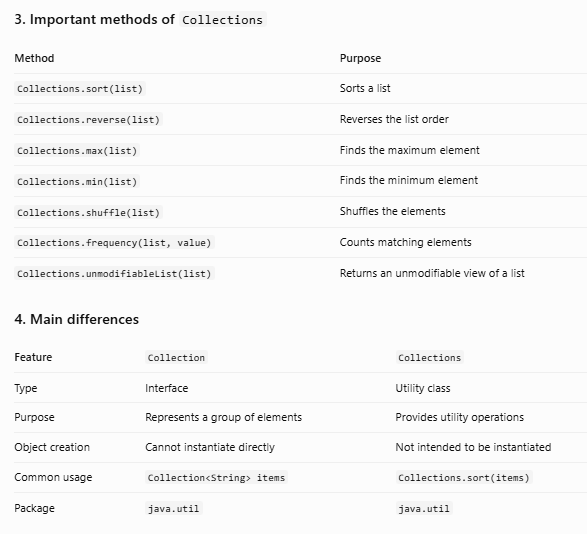
5. Interview-ready answer
Collection is an interface in the Java Collections Framework that represents a group of objects and defines common operations such as adding and removing elements. Collections is a utility class that provides static methods to operate on collection objects, such as sorting, reversing, shuffling, and finding minimum or maximum values. For example, I can declare a Collection<Integer> to hold numbers and use Collections.sort() on a compatible List<Integer> to sort them.

Quick memory trick
Collection → Stores or represents a group of objects.

Collections → Provides utility methods to work with them.

=========================================================================================================================
38. What is the difference between List, Set, and Map in Java?
First, remember this simple rule:
- List → Allows duplicate elements and maintains positional order.
- Set → Stores unique elements.
- Map → Stores key-value pairs with unique keys.
Let's understand each one with simple Java examples.
1. List — stores elements in order
A List stores elements in a sequence. It allows duplicates and lets you access elements by their index.
Java example
import java.util.ArrayList;
import java.util.List;

public class Main {
    public static void main(String[] args) {

        List<String> names = new ArrayList<>();

        names.add("Rahul");
        names.add("Priya");
        names.add("Rahul");

        System.out.println(names);
        System.out.println(names.get(1));
    }
}

Output:
[Rahul, Priya, Rahul]
Priya

Why use List?
- You want to keep elements in sequence.
- You want to allow duplicate values.
- You need to access elements by index.
Examples: Product lists, employee lists, order items.
2. Set — stores unique elements
A Set does not allow duplicate elements according to its equality rules.
Java example
import java.util.HashSet;
import java.util.Set;

public class Main {
    public static void main(String[] args) {

        Set<String> names = new HashSet<>();

        names.add("Rahul");
        names.add("Priya");
        names.add("Rahul");

        System.out.println(names);
    }
}

Possible output:
[Rahul, Priya]

The order may vary because HashSet does not guarantee iteration order.

Why use Set?
- You want unique elements.
- You want to remove duplicates.
- You want to check whether an element exists.
Examples: Unique product categories, unique user IDs, distinct permissions.
3. Map — stores key-value pairs
A Map stores data as key-value pairs. Each key is unique, but multiple keys can have the same value.
Java example
import java.util.HashMap;
import java.util.Map;

public class Main {
    public static void main(String[] args) {

        Map<Integer, String> employees = new HashMap<>();

        employees.put(101, "Rahul");
        employees.put(102, "Priya");
        employees.put(103, "Rahul");

        System.out.println(employees.get(101));
        System.out.println(employees);
    }
}

Output:
Rahul
{101=Rahul, 102=Priya, 103=Rahul}

The map's iteration order is not guaranteed.

Why use Map?
- You need to find a value using a key.
- You need to associate one piece of information with another.
- You want fast key-based lookups with an appropriate implementation.
Examples: Employee ID → employee details, product code → product, username → user information.
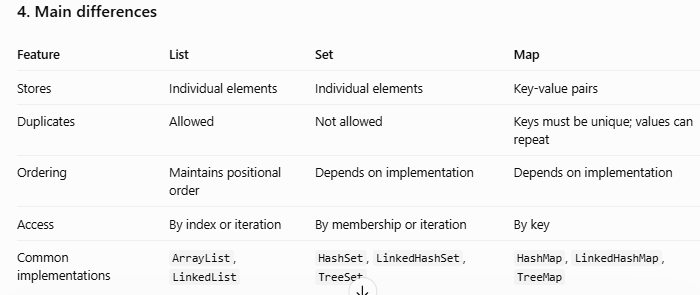

Remember: Map is part of the Java Collections Framework, but it does not extend the Collection interface.
5. Real-world Spring Boot example
Imagine you are building a shopping application.
List — display products
List<String> products =
    List.of("Laptop", "Mouse", "Laptop");

Keeps both occurrences of Laptop.

Set — unique categories
Set<String> categories =
    new HashSet<>();

Stores each category once.

Map — find product by ID
Map<Long, String> products =
    new HashMap<>();

products.put(101L, "Laptop");

Retrieves the product name using ID 101.

6. Interview-ready answer
List, Set, and Map are commonly used interfaces in Java to store and manage data. List maintains positional order and allows duplicate elements. Set stores unique elements and does not guarantee ordering unless an ordered implementation is used. Map stores key-value pairs, where keys are unique but values can be duplicated. For example, I use a List to display products, a Set to maintain unique categories, and a Map to retrieve product information by ID.

Quick memory trick
List → Duplicates allowed

Set → Unique elements

Map → Key-value pairs
=========================================================================================================================
39. What is the difference between ArrayList and LinkedList in Java?
First, remember this simple rule:
- ArrayList → Uses a dynamic array; fast for accessing elements by index.
- LinkedList → Uses linked nodes; can insert or remove elements efficiently when the position is already known.
Both implement the List interface, allow duplicate elements, and maintain positional order.
1. ArrayList — stores elements in a dynamic array
Simple meaning
Imagine a row of boxes placed next to each other. Each box has an index, so you can quickly access a particular position.

That is similar to how an ArrayList works internally: it uses a resizable array.
Java example
import java.util.ArrayList;
import java.util.List;

public class Main {
    public static void main(String[] args) {

        List<String> names = new ArrayList<>();

        names.add("Rahul");
        names.add("Priya");
        names.add("Amit");

        System.out.println(names.get(1));
    }
}

Output:
Priya

How does it work?
- add() adds an element to the list.
- get(1) accesses the element at index 1.
- Index-based access is fast because the elements are stored in an array.
Remember: ArrayList is a good default choice when you frequently read elements or iterate through a list.
2. LinkedList — stores elements as linked nodes
Simple meaning
Imagine a chain where each link points to the next link and the previous link.

A Java LinkedList uses nodes linked in both directions. Each node stores an element and references to neighboring nodes.
Java example
import java.util.LinkedList;
import java.util.List;

public class Main {
    public static void main(String[] args) {

        List<String> names = new LinkedList<>();

        names.add("Rahul");
        names.add("Priya");
        names.add("Amit");

        System.out.println(names.get(1));
    }
}

Output:
Priya

Both lists produce the same result, but their internal structures differ.

How does it work?
- Each node links to its neighboring nodes.
- To access an element by index, Java must traverse the nodes.
- Adding or removing a node can be efficient when its location is already available.
Remember: LinkedList can be useful for certain insertion, removal, and deque operations, but it is not automatically faster than ArrayList.
3. Main differences
Feature	ArrayList	LinkedList
Internal structure	Resizable array	Doubly linked nodes
Access by index	Fast — \(O(1)\)	Slower — \(O(n)\)
Add at end	Amortized \(O(1)\)	\(O(1)\)
Insert/remove in the middle	Usually \(O(n)\) due to shifting	\(O(1)\) after reaching the node; locating it may take \(O(n)\)
Memory usage	Generally lower per element	Higher due to node references
Cache performance	Usually better	Often worse due to node traversal
Best for	Frequent reads and iteration	Specific deque or node-based operations
4. Understand performance with an example
Suppose a list contains 100,000 employee names, and you frequently need the employee at index 50,000.

With an ArrayList:
names.get(50000);

Java can access the array position directly, so the operation takes \(O(1)\) time.

With a LinkedList, Java must traverse from one end toward the requested position, so indexed access takes \(O(n)\) time.

Now suppose you already have an iterator positioned at the required location and need to remove an element. A LinkedList can unlink that node in \(O(1)\) time. With an ArrayList, removing an element from the middle typically requires shifting later elements, taking \(O(n)\) time.

Important: If you must first search for the middle element in a LinkedList, that search still takes \(O(n)\). This is why LinkedList is not necessarily the better choice for frequent middle insertions or removals.
5. Real-world Spring Boot example
Imagine your application loads products from a database.
List<Product> products = productRepository.findAll();

If you frequently access products by index or iterate over them, an ArrayList is generally the better choice.

If you need queue-like operations at both ends, such as adding or removing pending tasks from either end, a LinkedList can implement a Deque. In many such cases, ArrayDeque is also worth considering because it usually has better memory locality and lower per-element overhead.
6. Interview-ready answer
You can remember and say:
ArrayList and LinkedList both implement the List interface, but they use different internal data structures. ArrayList uses a dynamic array, so indexed access is fast, typically O(1). LinkedList uses a doubly linked list, so accessing an element by index takes O(n), but inserting or removing a node is O(1) once the node is reached. LinkedList also uses more memory because each node stores references. In most application code, I prefer ArrayList for general-purpose lists and choose LinkedList only when its specific operations provide a real benefit.

Quick memory trick
ArrayList → Fast index access.

LinkedList → Linked nodes; index access requires traversal.
=========================================================================================================================
40. How does ArrayList grow internally in Java?
First, remember this simple rule:

ArrayList uses a dynamic array. When the array becomes full, Java creates a bigger array and copies the existing elements into it.

Let's understand step by step.
1. What happens internally?
Suppose you create an ArrayList:
ArrayList<Integer> numbers = new ArrayList<>();

An ArrayList internally uses an array to store elements.

Two important terms:
- Size → Number of elements currently stored.
- Capacity → Number of elements the internal array can hold before it needs to grow.
For example, if the capacity is 5 and the list contains 3 elements:
ArrayList internal array
10

20

30

Empty

Empty

Size = 3

Capacity = 5

The list has 3 elements, but it has space for 2 more without growing.
2. What happens when the array becomes full?
Suppose the capacity is 5 and you add a sixth element.
numbers.add(10);
numbers.add(20);
numbers.add(30);
numbers.add(40);
numbers.add(50);
numbers.add(60);

Conceptually, the process is:
Step 1: Old array is full
10

20

30

40

50

Capacity = 5

Java allocates a larger array

Step 2: Elements are copied
10

20

30

40

50

60

New array has enough capacity for all 6 elements.

Java allocates a larger internal array, copies the existing elements into it, and then adds the new element.

The exact new capacity depends on the JDK implementation.
3. How much does ArrayList grow?
In commonly used OpenJDK implementations, the capacity typically grows by approximately 50% when the existing array needs to expand.

For example, the following is a simplified growth sequence:
Old capacity	New capacity
10	15
15	22
22	33
33	49

These values illustrate the common OpenJDK growth strategy; the Java API does not guarantee this exact growth factor.

What about the first insertion?

With the default constructor, modern OpenJDK implementations generally allocate the backing array lazily. The first insertion creates an array with capacity 10. If you specify an initial capacity yourself, growth starts from that capacity instead.
4. Why doesn't Java increase the capacity by just one?
Imagine increasing capacity by only one slot every time the array becomes full.

If you add 1,000 elements, Java may need to create and copy arrays many times.

By increasing capacity more substantially, Java reduces how often it needs to resize the array.

This is why ArrayList has amortized O(1) time complexity for adding elements at the end: most individual additions are inexpensive, although an addition that triggers resizing can take O(n) time.
5. Interview-ready answer
You can remember and say:
ArrayList internally uses a resizable array. It maintains a size, which represents the number of elements, and a capacity, which represents the available array slots. When the array becomes full, Java allocates a larger array and copies the existing elements into it. In common OpenJDK implementations, the capacity typically grows by approximately 50%. Resizing takes O(n) time, but adding elements at the end is amortized O(1).

Quick memory trick
Array full → Create bigger array → Copy elements → Add new element.
=========================================================================================================================
41. How does HashMap work internally in Java 8 and later?
First, remember this simple rule:

HashMap stores data as key-value pairs. It uses the key's hash code to find a bucket, then uses equals() to identify the correct key.

For example, in a Spring Boot application, you might store an employee ID as a key and the employee's name as a value.
1. What is a HashMap?
import java.util.HashMap;
import java.util.Map;

public class Main {
    public static void main(String[] args) {

        Map<Integer, String> employees = new HashMap<>();

        employees.put(101, "Rahul");
        employees.put(102, "Priya");
        employees.put(103, "Amit");

        System.out.println(employees.get(102));
    }
}

Output:
Priya

Here:
- 101, 102, and 103 are keys.
- "Rahul", "Priya", and "Amit" are values.
- put() inserts or updates a key-value pair.
- get() retrieves a value using its key.
2. How does HashMap store data internally?
In Java 8 and later, HashMap uses an array of buckets. Each bucket can store entries in a linked list or, when necessary, a balanced tree. 

GitHub

Think of the buckets as numbered boxes where entries are stored.
HashMap internal table (simplified)
Bucket 0

Empty

Bucket 1
101 = Rahul

Bucket 2

Empty

Bucket 3
102 = Priya

Bucket 4

Empty

Bucket 5
103 = Amit

Illustration only. The actual bucket positions depend on the keys' hash values and table capacity.

Now let's understand exactly what happens when you call put() and get().
3. What happens internally when you call put()?
Consider:
employees.put(101, "Rahul");

Java performs these steps:
1. Calculate the hash. Java calls the key's hashCode() and spreads its bits to help distribute keys across the table.
2. Calculate the bucket index. The hash and the table's capacity determine which bucket will hold the entry.
3. Check the bucket. If it is empty, Java inserts a new entry. If it already contains entries, Java checks them for a matching key.
4. Compare keys. Java uses hash equality and then equals() when needed to determine whether the key already exists.
5. Insert or update. If the key already exists, its value is updated. Otherwise, a new entry is added to the bucket.
The entry stores the key, value, computed hash, and a link to the next entry when the bucket uses a linked structure. 

GitHub
+1

4. What is a hash collision?
A collision occurs when two different keys are assigned to the same bucket.

For example, imagine these two keys end up in bucket 3:
Bucket 3

Key A → Value A

Key B → Value B

Two entries in the same bucket

Java handles collisions by storing multiple entries in the same bucket.

In Java 8 and later, the bucket generally starts as a linked list. If the bucket becomes too crowded, Java can convert it into a red-black tree, which allows faster searching in that bucket.
What is treeification?
In the standard OpenJDK implementation:
- The treeification threshold is 8 entries.
- The table generally needs a capacity of at least 64 before a bucket is converted into a tree.
- If the table is smaller, Java generally resizes it instead of immediately converting the bucket to a tree.
These are implementation details, not guarantees of the HashMap API. 

GitHub

Remember: Collision → Linked list → Possibly a red-black tree.
5. What happens internally when you call get()?
Consider:
employees.get(102);

Java follows a similar process:
1. Calculate the hash of key 102.
2. Find the appropriate bucket.
3. Search the entries in that bucket.
4. Compare the key with the requested key, using the hash and equality checks.
5. Return the value if the key is found; otherwise, return null.
When keys are distributed well, get() is typically very fast.
6. What happens when two keys have the same hash code?
Consider two different String keys:
Map<String, String> map = new HashMap<>();

map.put("FB", "Facebook");
map.put("Ea", "Example");

System.out.println(map.get("FB"));
System.out.println(map.get("Ea"));

Output:
Facebook
Example

"FB" and "Ea" have the same Java String hash code, but they are not equal according to String.equals().

Therefore, both entries can exist in the same map. Java uses equality checks to distinguish them.

Important interview rule:
- Same hash code does not mean the keys are equal.
- If two keys are equal according to equals(), they must have the same hash code.
- Different keys can have the same hash code.
7. What is the load factor, and when does HashMap grow?
A HashMap grows when its number of entries exceeds its resize threshold.

By default, the standard implementation uses:
- Initial capacity: 16 buckets, allocated when the table is first needed.
- Load factor: 0.75.
- Initial resize threshold: approximately 16 × 0.75 = 12 entries.
When resizing occurs, the table typically grows to about twice its previous capacity, and entries are redistributed into the new table. 

GitHub

For example:
Capacity	Resize threshold
16	12
32	24
64	48
128	96

These numbers illustrate the default growth policy in the standard implementation.

Resizing can be expensive because entries must be redistributed. If you know the expected number of entries, choosing a suitable initial capacity can reduce resizing.
8. Time complexity
Operation	Typical performance	Worst-case consideration
put()	\(O(1)\) average	Can take longer during collisions or resizing
get()	\(O(1)\) average	Can degrade with heavy collisions
remove()	\(O(1)\) average	Depends on bucket structure and collisions

Java 8's tree bins can improve heavily populated bucket searches to approximately \(O(\log n)\) under suitable conditions. This is an implementation optimization, not a universal guarantee for every possible key type.
9. Important production considerations
When using HashMap in a Spring Boot application:
- Prefer immutable keys, such as String, or custom keys whose equality-related fields do not change.
- Correctly implement equals() and hashCode() for custom key classes.
- Don't rely on HashMap iteration order.
- Remember that HashMap is not thread-safe for concurrent structural modifications. Use ConcurrentHashMap when its concurrent access behavior fits the requirement. 
  
  Oracle Docs
10. Interview-ready answer
In Java 8 and later, HashMap internally uses an array of buckets. When we insert a key-value pair, it calculates a hash from the key's hashCode(), determines the bucket index, and checks whether the key already exists. If the key exists, its value is updated; otherwise, a new entry is inserted. If multiple keys map to the same bucket, HashMap handles the collision using a linked list and can convert a heavily populated bucket into a red-black tree. HashMap also resizes when its size exceeds the load-factor threshold. Its average put() and get() performance is O(1), assuming good hash distribution.

Quick memory trick
put() → Hash → Bucket → Compare → Insert or update

get() → Hash → Bucket → Compare → Return value

Collision → Linked list → Possibly a red-black tree

Threshold exceeded → Resize the table
=========================================================================================================================
42. How does HashSet work internally in Java?
First, remember this simple rule:

HashSet uses a HashMap internally to store elements and prevent duplicates.

It stores unique elements, does not guarantee their iteration order, and allows one null element. 

Oracle Docs
+1

1. What is a HashSet?
A HashSet is a collection used when you want to store unique values.
import java.util.HashSet;
import java.util.Set;

public class Main {
    public static void main(String[] args) {

        Set<String> names = new HashSet<>();

        names.add("Rahul");
        names.add("Priya");
        names.add("Rahul");

        System.out.println(names.size());
        System.out.println(names.contains("Priya"));
    }
}

Output:
2
true

Why is the size 2?

We added "Rahul" twice, but HashSet stores only one copy of an equal element.
2. How does HashSet work internally?
In the standard OpenJDK implementation, HashSet uses a HashMap internally. The elements you add become the keys in that map, and a shared dummy object is used as the value. 

GitHub
+1

For example:
Set<String> names = new HashSet<>();

names.add("Rahul");
names.add("Priya");

Conceptually, the internal map looks like this:
HashSet elements
"Rahul"

"Priya"

Internal HashMap (simplified)
Key: "Rahul"

Value: dummy object

Key: "Priya"

Value: dummy object

The map stores the elements as keys. The dummy value is not meaningful application data.

3. What happens when you call add()?
Consider:
names.add("Rahul");

Internally, the process is:
1. Calculate the hash: Java uses the element's hashCode() to help determine where it belongs.
2. Find the bucket: The hash determines the bucket in the internal HashMap.
3. Check for duplicates: Java uses the hash and equals() to check whether an equal element already exists.
4. Store the element: If it is new, the internal map stores the element as a key with a dummy value.
5. Skip duplicates: If an equal element already exists, the set does not add another copy.
The standard implementation effectively uses map.put(element, PRESENT) to implement add(). 

GitHub

4. What happens when we add a duplicate?
Set<String> names = new HashSet<>();

System.out.println(names.add("Java"));
System.out.println(names.add("Java"));

Output:
true
false

Why?
- First add("Java"): the element is new, so the method returns true.
- Second add("Java"): an equal element already exists, so the method returns false.
Even if you create two different String objects with the same contents, HashSet treats them as equal:
Set<String> names = new HashSet<>();

names.add(new String("Java"));
names.add(new String("Java"));

System.out.println(names.size());

Output:
1

This works because String implements content-based equals() and a consistent hashCode().
5. What happens when two elements have the same hash code?
This is called a hash collision.

Two different elements can have the same hash code. Java then checks equality to determine whether they are duplicates.
- If equals() returns true, the second element is not added.
- If equals() returns false, both elements can be stored.
This is why correctly implementing equals() and hashCode() is important for custom objects used in a HashSet.
6. Performance and important points
Feature	HashSet
Internal implementation	Uses a HashMap in OpenJDK
Duplicate elements	Not allowed
null	One null element is allowed
Iteration order	Not guaranteed
add(), remove(), contains()	Typically \(O(1)\) with good hash distribution
Thread safety	Not synchronized by default

These performance characteristics assume that elements are distributed properly among buckets. 

Oracle Docs
+1

7. Interview-ready answer
HashSet internally uses a HashMap in the standard Java implementation. When we add an element, it is stored as a key in the internal map, and a shared dummy object is used as its value. HashSet uses hashCode() to help find the correct bucket and equals() to determine whether an equal element already exists. If the element is new, it is added; if it is a duplicate, it is not added. This gives typically constant-time performance for add, remove, and contains operations when hash distribution is good.

Quick memory trick
HashSet → Internally uses HashMap

Element → Map key

Dummy object → Map value

hashCode() + equals() → Detect duplicates
=========================================================================================================================
43. What happens when two keys have the same hash code in Java?
First, remember this simple rule:

Same hash code → Hash collision → Java uses equals() to check whether the keys are equal.

If the keys are different, both can be stored in a HashMap.
1. Understand with a simple example
Imagine two people have the same house number, but their names are different. You need another way to identify the correct person.

Similarly, two keys can have the same hash code, but Java uses equals() to distinguish them.
2. Java example
Java's Strings "FB" and "Ea" have the same hash code.
import java.util.HashMap;
import java.util.Map;

public class Main {
    public static void main(String[] args) {

        Map<String, String> map = new HashMap<>();

        map.put("FB", "Facebook");
        map.put("Ea", "Example");

        System.out.println("FB hash: " + "FB".hashCode());
        System.out.println("Ea hash: " + "Ea".hashCode());

        System.out.println(map.get("FB"));
        System.out.println(map.get("Ea"));
        System.out.println(map.size());
    }
}

Output:
FB hash: 2236
Ea hash: 2236
Facebook
Example
2

Both keys have the same hash code, but they are not equal according to String.equals().

Therefore, HashMap stores both entries.
3. What happens internally?
When you execute:
map.put("FB", "Facebook");
map.put("Ea", "Example");

Java performs these steps:
1. Calculates the hash for each key.
2. Determines the bucket where each entry belongs.
3. Detects that the keys have the same hash code.
4. Uses equals() to check whether the keys are equal.
5. Because "FB".equals("Ea") returns false, both entries are stored.
In Java 8 and later, entries that collide in the same bucket can be stored in a linked list or, in certain circumstances, a red-black tree.
4. What if both keys are equal?
Map<String, String> map = new HashMap<>();

map.put("Java", "First");
map.put(new String("Java"), "Second");

System.out.println(map.size());
System.out.println(map.get("Java"));

Output:
1
Second

Both String objects have equal content, so HashMap treats them as the same key. The second put() updates the existing value instead of creating a second entry.
5. Important interview points
Situation	Result
Same hash code, different keys	Both can be stored
Same hash code, equal keys	One mapping; a new value updates the old value
Different hash codes	Keys cannot be equal under a correct equals()/hashCode() implementation
Collision occurs	HashMap uses equality checks to distinguish keys

Remember the contract: If two objects are equal according to equals(), they must have the same hashCode(). The reverse is not required.
Interview-ready answer
When two keys have the same hash code, a hash collision occurs. HashMap uses the hash to locate a bucket and then uses equals() to determine whether the keys represent the same key. If they are different, both entries can be stored in the same bucket. If they are equal, the existing entry's value is updated. In Java 8 and later, a heavily populated bucket can use a red-black tree instead of a linked list.

Quick memory trick: hashCode() finds the bucket; equals() identifies the key.
=========================================================================================================================
44. What happens if two unequal keys have the same hash code?
First, remember this simple rule:

Same hash code + unequal keys = Hash collision, but both keys can be stored in a HashMap.

Let's understand step by step.
1. Simple Java example
In Java, the String keys "FB" and "Ea" have the same hash code but are not equal.
import java.util.HashMap;
import java.util.Map;

public class Main {
    public static void main(String[] args) {

        Map<String, String> map = new HashMap<>();

        map.put("FB", "Facebook");
        map.put("Ea", "Example");

        System.out.println("FB hash: " + "FB".hashCode());
        System.out.println("Ea hash: " + "Ea".hashCode());

        System.out.println(map.get("FB"));
        System.out.println(map.get("Ea"));
        System.out.println(map.size());
    }
}

Output:
FB hash: 2236
Ea hash: 2236
Facebook
Example
2

Why are both entries stored?
- "FB" and "Ea" have the same hash code.
- "FB".equals("Ea") returns false.
- Therefore, Java treats them as different keys and stores both entries.
2. What happens internally?
When we execute:
map.put("FB", "Facebook");
map.put("Ea", "Example");

Java performs these steps:
Key: "FB"

Hash code: 2236

Key: "Ea"

Hash code: 2236

Same bucket — collision

Java compares the keys using equals().

Both entries are stored

Because the keys are unequal.

In Java 8 and later, colliding entries can be stored in a linked list or, under certain conditions, a red-black tree.
3. What happens when we retrieve the values?
System.out.println(map.get("FB"));
System.out.println(map.get("Ea"));

Output:
Facebook
Example

Even though both keys have the same hash code, Java uses equality checks to find the correct key and return its corresponding value.
4. Interview-ready answer
When two unequal keys have the same hash code, a hash collision occurs. HashMap maps both keys to the same bucket and uses equals() to distinguish them. Since equals() returns false, both key-value pairs are stored separately. In Java 8 and later, the bucket can use a linked list or be converted into a red-black tree when the relevant conditions are met.

Quick memory trick
Same hash code → Same bucket may occur.

equals() returns false → Both keys can exist in the HashMap.
=========================================================================================================================
45. Why should equals() and hashCode() be overridden together in Java?
First, remember this simple rule:

If two objects are equal according to equals(), they must have the same hashCode().

Both methods work together in collections such as HashMap and HashSet.
1. Understand with a simple example
Imagine two employee objects:
- Employee 1: ID = 101, Name = Rahul
- Employee 2: ID = 101, Name = Rahul
Both objects represent the same employee according to our business rule, even though they are two separate Java objects.

We want Java to treat them as equal.
2. What does equals() do?
The equals() method checks whether two objects should be considered logically equal.
3. What does hashCode() do?
The hashCode() method returns an integer that helps hash-based collections find the appropriate bucket for an object.

A HashMap uses the hash to locate a bucket and then uses equality checks to identify the correct key.
4. What goes wrong if we override only equals()?
Consider this example:
import java.util.HashSet;
import java.util.Objects;
import java.util.Set;

class Employee {
    int id;

    Employee(int id) {
        this.id = id;
    }

    @Override
    public boolean equals(Object obj) {
        if (this == obj) return true;
        if (!(obj instanceof Employee)) return false;

        Employee other = (Employee) obj;
        return this.id == other.id;
    }

    // hashCode() is not overridden!
}

public class Main {
    public static void main(String[] args) {
        Set<Employee> employees = new HashSet<>();

        employees.add(new Employee(101));
        employees.add(new Employee(101));

        System.out.println(employees.size());
    }
}

You might expect the output to be 1, because both employees have the same ID.

But it can print:
2

Why?
1. We created two different objects with the same ID.
2. Our equals() method considers them equal.
3. But the inherited hashCode() method may give the two objects different hash codes.
4. HashSet may place them in different buckets and never compare them with each other.
5. Both objects can therefore remain in the set.
This violates the expected behavior of a Set.
5. Correct approach — override both methods
import java.util.HashSet;
import java.util.Objects;
import java.util.Set;

class Employee {
    private final int id;

    Employee(int id) {
        this.id = id;
    }

    @Override
    public boolean equals(Object obj) {
        if (this == obj) return true;
        if (!(obj instanceof Employee)) return false;

        Employee other = (Employee) obj;
        return this.id == other.id;
    }

    @Override
    public int hashCode() {
        return Objects.hash(id);
    }
}

public class Main {
    public static void main(String[] args) {
        Set<Employee> employees = new HashSet<>();

        employees.add(new Employee(101));
        employees.add(new Employee(101));

        System.out.println(employees.size());
    }
}

Output:
1

Now both objects have the same ID, compare equal, and produce the same hash code. The HashSet stores only one of them.
6. Important rules to remember
- If a.equals(b) is true, then a.hashCode() must equal b.hashCode().
- If two objects have the same hash code, they are not necessarily equal.
- If two objects are unequal, they may still have the same hash code.
- Fields used by equals() and hashCode() should generally not change while an object is being used as a key in a HashMap or stored in a HashSet.
7. Real-world Spring Boot example
Suppose you use an Employee object as a key in a HashMap.
Map<Employee, String> employeeMap = new HashMap<>();

employeeMap.put(new Employee(101), "Developer");

System.out.println(
    employeeMap.get(new Employee(101))
);

Output:
Developer

This works because both Employee objects compare equal and have matching hash codes.

Without correct implementations of both methods, looking up the value using a logically equivalent employee object may fail.
8. Interview-ready answer
We should override equals() and hashCode() together because hash-based collections such as HashMap and HashSet depend on both methods. hashCode() helps locate the bucket, while equals() checks whether the keys are logically equal. The Java contract requires equal objects to have the same hash code. If we override only equals(), equal objects may have different hash codes, causing incorrect lookup behavior or duplicates in a HashSet. Therefore, whenever I override equals(), I also override hashCode() using the same equality fields.

Quick memory trick
hashCode() → Find the bucket.

equals() → Check equality.

Override both → Correct behavior in HashMap and HashSet.
=========================================================================================================================
46. What happens if a mutable object is used as a HashMap key?
46. What happens if a mutable object is used as a HashMap key?
First, remember this simple rule:

If a key's fields used by equals() or hashCode() change after insertion, you may not be able to find that key in the HashMap.

Let's understand with a simple Java example.

1. What is a mutable object?
A mutable object is an object whose data can change after it has been created.

For example, an employee's ID can change:

class Employee {
    int id;

    Employee(int id) {
        this.id = id;
    }
}

Here, id is not final, so it can be modified after creating the object.

2. Java example — mutable object as a key
Suppose Employee uses its id to calculate its hash code and compare equality.

import java.util.HashMap;
import java.util.Map;
import java.util.Objects;

class Employee {
    int id;

    Employee(int id) {
        this.id = id;
    }

    @Override
    public int hashCode() {
        return Objects.hash(id);
    }

    @Override
    public boolean equals(Object obj) {
        if (this == obj) return true;
        if (!(obj instanceof Employee)) return false;

        Employee other = (Employee) obj;
        return this.id == other.id;
    }
}

public class Main {
    public static void main(String[] args) {

        Map<Employee, String> map = new HashMap<>();

        Employee emp = new Employee(101);
        map.put(emp, "Rahul");

        System.out.println(map.get(emp));

        emp.id = 202;

        System.out.println(map.get(emp));
        System.out.println(map.size());
    }
}

Output:

Rahul
null
1
Why does this happen?
Step 1: Insert the key

map.put(emp, "Rahul");

The employee's ID is 101. HashMap calculates and stores the hash associated with the key when inserting the entry.

Step 2: Change the key

emp.id = 202;

Now the employee's hash code changes because it depends on id.

Step 3: Try to retrieve the value

map.get(emp);

HashMap calculates the key's new hash and searches using it. The entry was stored using the old hash, so the lookup cannot find it and returns null.

Important: The entry has not automatically disappeared. The map still contains one entry, which is why map.size() prints 1.

3. What problems can this cause?
get(key) may return null even though the entry is still stored.

containsKey(key) may return false.

remove(key) may fail to remove the entry.

The map can continue holding an entry that is difficult to retrieve using normal key-based operations.

4. How do you avoid this problem?
Prefer immutable keys, or at least ensure the fields used by equals() and hashCode() do not change while the key is in the map.

For example, make the employee ID final:

class Employee {
    private final int id;

    Employee(int id) {
        this.id = id;
    }

    @Override
    public int hashCode() {
        return Integer.hashCode(id);
    }

    @Override
    public boolean equals(Object obj) {
        if (this == obj) return true;
        if (!(obj instanceof Employee)) return false;

        Employee other = (Employee) obj;
        return this.id == other.id;
    }
}

Now the ID cannot be changed after the object is created.

5. Interview-ready answer
Using a mutable object as a HashMap key can cause lookup problems if fields used by equals() or hashCode() change after insertion. HashMap stores the entry using the key's hash at insertion time. If the key's hash-related state later changes, operations such as get(), containsKey(), or remove() may fail to find the entry. To avoid this, I prefer immutable keys or ensure that equality-related fields remain unchanged while the key is in the map.

Quick memory trick
Mutable key changes → Hash may change → Lookup may fail.
=========================================================================================================================
47. What is the difference between HashMap, Hashtable, and ConcurrentHashMap?
First, remember this simple rule:
- HashMap → Not thread-safe by default.
- Hashtable → Thread-safe using synchronized methods, but it is a legacy class.
- ConcurrentHashMap → Thread-safe and designed for efficient access by multiple threads.
All three store data as key-value pairs, but they handle multiple threads differently.
1. HashMap — not thread-safe
Simple meaning
HashMap stores key-value pairs and is generally used when a map is accessed by one thread or when access is otherwise properly synchronized.
Java example
import java.util.HashMap;
import java.util.Map;

public class Main {
    public static void main(String[] args) {

        Map<Integer, String> employees = new HashMap<>();

        employees.put(101, "Rahul");
        employees.put(102, "Priya");

        System.out.println(employees.get(101));
    }
}

Output:
Rahul

Important points:
- It is not synchronized by default.
- It allows one null key and multiple null values.
- It does not guarantee iteration order.
- It generally provides fast get() and put() operations when hashes are distributed well.
If multiple threads access the same HashMap and at least one performs structural modifications, you must provide appropriate synchronization. 

Oracle Docs

2. Hashtable — synchronized, legacy implementation
Simple meaning
Hashtable is an older Java collection that synchronizes its methods to coordinate concurrent access.
import java.util.Hashtable;
import java.util.Map;

public class Main {
    public static void main(String[] args) {

        Map<Integer, String> employees = new Hashtable<>();

        employees.put(101, "Rahul");
        employees.put(102, "Priya");

        System.out.println(employees.get(101));
    }
}

Output:
Rahul

Important points:
- Its methods are synchronized.
- It does not allow null keys or null values.
- Synchronization can limit performance when many threads compete for the same map.
- It is generally avoided in new applications in favor of modern alternatives. 
  
  Android Developers
3. ConcurrentHashMap — designed for concurrent access
Simple meaning
ConcurrentHashMap is designed for applications where multiple threads access and update a shared map.
import java.util.concurrent.ConcurrentHashMap;
import java.util.Map;

public class Main {
    public static void main(String[] args) {

        Map<Integer, String> employees =
                new ConcurrentHashMap<>();

        employees.put(101, "Rahul");
        employees.put(102, "Priya");

        System.out.println(employees.get(101));
    }
}

Output:
Rahul

Important points:
- It supports concurrent reads and updates safely.
- Reads generally do not block on map locks.
- It does not allow null keys or values.
- It provides atomic operations such as putIfAbsent() and computeIfAbsent().
- Its iterators are weakly consistent, so they can reflect concurrent updates without throwing ConcurrentModificationException. 
  
  Oracle Docs
4. Main differences
Feature	HashMap	Hashtable	ConcurrentHashMap
Thread-safe by default?	No	Yes	Yes
Synchronization	None by default	Synchronized methods	Designed for concurrent access
null key	One allowed	Not allowed	Not allowed
null values	Allowed	Not allowed	Not allowed
Concurrent performance	Requires external coordination for shared modifications	Can suffer from lock contention	Generally better for concurrent workloads
Iterator behavior	Fail-fast, best effort	Fail-fast iterators; legacy enumerations also exist	Weakly consistent
Typical use	Single-threaded or externally synchronized code	Legacy applications	Shared maps accessed by multiple threads

5. Real-world Spring Boot example
Imagine you are developing an application with many HTTP requests arriving at the same time.

Suppose the application keeps frequently accessed employee details in an in-memory map.
Scenario A: HashMap

Suitable for a local map confined to one request or one thread. For shared mutable state, additional synchronization is required.

Scenario B: Hashtable

Provides synchronized operations, but contention can become a bottleneck when many threads access the same map.

Scenario C: ConcurrentHashMap

A good choice for shared in-memory data accessed by multiple request-handling threads, such as a local cache or lookup registry.

Example:
private final Map<Long, String> employeeCache =
        new ConcurrentHashMap<>();

public void cacheEmployee(Long id, String name) {
    employeeCache.put(id, name);
}

public String getEmployee(Long id) {
    return employeeCache.get(id);
}

Multiple threads can call these methods without requiring you to synchronize each put() and get() yourself.

Production caution: Thread safety of the map does not automatically make a sequence of operations atomic. For example, instead of separately checking and inserting a missing value, use computeIfAbsent() when its semantics fit your requirement.

Also, a ConcurrentHashMap is only an in-memory map within one application instance. It does not automatically share cached data across multiple Spring Boot instances.
6. Interview-ready answer
You can remember and say:
HashMap, Hashtable, and ConcurrentHashMap all store key-value pairs. HashMap is not thread-safe by default and allows null keys and values. Hashtable is a legacy synchronized implementation that does not permit null keys or values. ConcurrentHashMap is designed for concurrent applications, supports efficient concurrent access, and also prohibits null keys and values. In a Spring Boot application with multiple request-handling threads, I generally prefer ConcurrentHashMap for shared in-memory mappings when a concurrent map is appropriate.

Quick memory trick
HashMap → No built-in synchronization

Hashtable → Synchronized, legacy

ConcurrentHashMap → Concurrent access, preferred for many shared-map use cases
=========================================================================================================================
48. How does ConcurrentHashMap achieve thread safety in Java?
First, remember this simple rule:

ConcurrentHashMap allows multiple threads to read and update a shared map safely without locking the entire map for every operation. 

Oracle Docs
+1

Let's understand this step by step.
1. Why do we need ConcurrentHashMap?
Imagine your Spring Boot application receives 100 HTTP requests at the same time. All requests access a shared map containing employee details.
Map<Integer, String> employees = new HashMap<>();

If multiple threads modify this HashMap concurrently without proper synchronization, the results may be incorrect.

Instead, you can use:
Map<Integer, String> employees =
        new ConcurrentHashMap<>();

This map is designed to handle concurrent access safely.
2. How does it achieve thread safety?
There are four important ideas to understand.
1. It does not lock the entire map for every operation
Unlike Hashtable, ConcurrentHashMap does not synchronize every operation on the whole map.

This allows different threads to work with different parts of the map concurrently. Reads such as get() generally do not require locking. 

Oracle Docs
+1

2. It uses CAS for certain updates
CAS stands for Compare-And-Swap.

In simple words, CAS means:
Update a value only if it still contains the value I expect. Otherwise, try again.

In common OpenJDK implementations, CAS helps insert an entry into an empty bucket without acquiring a lock.
3. It uses locking for updates when needed
When a bucket already contains entries, an update may synchronize on that bucket's first node while changing its contents.

This helps coordinate conflicting updates without locking the entire map.
4. It uses memory-visibility mechanisms
Mechanisms such as volatile fields, atomic operations, and synchronization help ensure that threads see updates correctly.

These implementation techniques work together to provide thread-safe map operations. 

GitHub
+1

3. Simple visual example
Imagine two threads accessing the same map.
Thread 1

Updates employee 101

Thread 2

Reads employee 202

ConcurrentHashMap

Coordinates shared access safely

Different operations can proceed concurrently where possible. Conflicting updates are coordinated.

The important point is that one thread does not necessarily have to wait for every operation performed by another thread.
4. Java example using ConcurrentHashMap
import java.util.concurrent.ConcurrentHashMap;
import java.util.Map;

public class Main {

    public static void main(String[] args) {

        Map<Integer, String> employees =
                new ConcurrentHashMap<>();

        employees.put(101, "Rahul");
        employees.put(102, "Priya");

        System.out.println(employees.get(101));

        employees.remove(102);
    }
}

Output:
Rahul

The map safely supports concurrent reads and updates from multiple threads.
5. Important interview point: putIfAbsent() and computeIfAbsent()
ConcurrentHashMap provides atomic methods that are useful for concurrent applications.

For example:
ConcurrentHashMap<String, String> cache =
        new ConcurrentHashMap<>();

cache.putIfAbsent("USER101", "Rahul");

putIfAbsent() inserts the value only if the key does not already have a mapping.

Similarly:
cache.computeIfAbsent(
    "USER102",
    key -> loadUserNameFromDatabase(key)
);

computeIfAbsent() can atomically compute and install a missing value for a key. This is useful for caches, although the mapping function should be short and should not attempt conflicting updates to the same map.

Senior-level caution: Thread-safe individual methods do not automatically make a sequence of multiple operations atomic. For example, a separate get() followed by put() can still have a race condition. Use an appropriate atomic map operation when required.
6. Real-world Spring Boot example
Suppose a service maintains an in-memory cache of employee names shared by concurrent HTTP requests.
import java.util.concurrent.ConcurrentHashMap;
import org.springframework.stereotype.Service;

@Service
public class EmployeeCacheService {

    private final ConcurrentHashMap<Long, String> cache =
            new ConcurrentHashMap<>();

    public void cacheEmployee(Long id, String name) {
        cache.put(id, name);
    }

    public String getEmployeeName(Long id) {
        return cache.get(id);
    }
}

Multiple request-handling threads can access this map safely.

Remember that this cache exists within one application instance. If several Spring Boot instances need to share cached data, you may need a distributed cache such as Redis.
7. Interview-ready answer
ConcurrentHashMap achieves thread safety using a combination of techniques rather than locking the entire map for every operation. In Java 8 and later OpenJDK implementations, it uses CAS for certain updates, synchronization for conflicting updates within a bucket, and memory-visibility mechanisms to coordinate access. Reads generally do not require locking. It also provides atomic operations such as putIfAbsent() and computeIfAbsent(). I use ConcurrentHashMap when multiple threads need to access shared in-memory data safely and efficiently.

Quick memory trick
Reads → Generally no locking

Some insertions → CAS

Conflicting bucket updates → Synchronization

Atomic map operations → putIfAbsent(), computeIfAbsent()
=========================================================================================================================
49. What is the difference between HashMap and LinkedHashMap?
First, remember this simple rule:
- HashMap → Does not guarantee the order of elements.
- LinkedHashMap → Maintains a predictable iteration order, usually insertion order.
Both store data as key-value pairs, and both allow one null key and multiple null values.
1. HashMap — no guaranteed order
Simple meaning
HashMap stores key-value pairs, but it does not guarantee the order in which entries are returned during iteration.
Java example
import java.util.HashMap;
import java.util.Map;

public class Main {
    public static void main(String[] args) {

        Map<Integer, String> map = new HashMap<>();

        map.put(103, "Amit");
        map.put(101, "Rahul");
        map.put(102, "Priya");

        System.out.println(map);
    }
}

The output may look like:
{101=Rahul, 102=Priya, 103=Amit}

However, this order is not guaranteed. You must not depend on it.
2. LinkedHashMap — maintains insertion order by default
Simple meaning
LinkedHashMap is similar to HashMap, but it also maintains links between entries so that iteration follows a predictable order.
Java example
import java.util.LinkedHashMap;
import java.util.Map;

public class Main {
    public static void main(String[] args) {

        Map<Integer, String> map = new LinkedHashMap<>();

        map.put(103, "Amit");
        map.put(101, "Rahul");
        map.put(102, "Priya");

        System.out.println(map);
    }
}

Output:
{103=Amit, 101=Rahul, 102=Priya}

Why? Entries are returned in the order in which their keys were first inserted.
3. How do they work internally?
- HashMap: Uses a hash table with buckets to store entries.
- LinkedHashMap: Uses the same basic hash-table approach, plus links connecting entries to maintain iteration order.
These links require additional memory.
4. Main differences
Feature	HashMap	LinkedHashMap
Ordering	No guaranteed order	Insertion order by default
Internal structure	Hash table	Hash table + linked entries
Null key	One allowed	One allowed
Null values	Allowed	Allowed
Performance	Generally slightly less overhead	Slightly more memory overhead
Iteration	Order is unspecified	Predictable iteration order
Typical use	Fast key-value lookup	Lookup while preserving order

5. Important interview point: Access-order LinkedHashMap
LinkedHashMap can also maintain access order instead of insertion order. This can be useful when implementing a simple LRU (Least Recently Used) cache.
LinkedHashMap<Integer, String> map =
    new LinkedHashMap<>(16, 0.75f, true);

The third constructor argument, true, enables access-order mode. Entries are then ordered according to access rather than their original insertion order.
6. Real-world Spring Boot example
Suppose an API returns a list of configuration entries or report fields where the output order must remain consistent.
- Use HashMap when you need key-value lookup but don't care about iteration order.
- Use LinkedHashMap when the response or report should preserve insertion order.
For example, LinkedHashMap can be useful when constructing an ordered response or preparing data for a report.
7. Interview-ready answer
HashMap and LinkedHashMap both store key-value pairs and provide efficient average-time lookup. HashMap does not guarantee iteration order, while LinkedHashMap maintains a predictable order, which is insertion order by default. Internally, LinkedHashMap uses a hash table along with links between entries, so it requires additional memory. I use HashMap when order does not matter and LinkedHashMap when iteration order must be preserved. LinkedHashMap can also support access-order iteration, which is useful for LRU cache implementations.

Quick memory trick
HashMap → Fast lookup, no guaranteed order.

LinkedHashMap → Fast lookup + predictable iteration order.
=========================================================================================================================
50. What is the difference between HashMap and TreeMap in Java?
First, remember this simple rule:
- HashMap → Stores key-value pairs without guaranteeing key order.
- TreeMap → Stores key-value pairs with keys sorted in ascending order by default.
Both are used to store key-value pairs, but they differ in ordering, internal structure, and performance.
1. HashMap — no guaranteed order
Simple meaning
HashMap stores data using a hash table. It does not guarantee the order in which keys are returned.
Java example
import java.util.HashMap;
import java.util.Map;

public class Main {
    public static void main(String[] args) {

        Map<Integer, String> employees = new HashMap<>();

        employees.put(103, "Amit");
        employees.put(101, "Rahul");
        employees.put(102, "Priya");

        System.out.println(employees);
    }
}

The iteration order is not guaranteed. You should not depend on the output being sorted or matching insertion order.

Remember: HashMap → Fast lookup, no guaranteed order.
2. TreeMap — sorted keys
Simple meaning
TreeMap stores key-value pairs in a sorted tree structure. By default, keys are sorted in ascending order.
Java example
import java.util.Map;
import java.util.TreeMap;

public class Main {
    public static void main(String[] args) {

        Map<Integer, String> employees = new TreeMap<>();

        employees.put(103, "Amit");
        employees.put(101, "Rahul");
        employees.put(102, "Priya");

        System.out.println(employees);
    }
}

Output:
{101=Rahul, 102=Priya, 103=Amit}

Although we inserted 103, 101, and 102 in that order, TreeMap returns entries sorted by their keys.

Remember: TreeMap → Sorted keys.
3. How do they work internally?
- HashMap: Uses an array of buckets, with linked lists or tree structures for handling collisions.
- TreeMap: Uses a self-balancing Red-Black tree to keep keys sorted.
This is why their performance differs.
4. Main differences
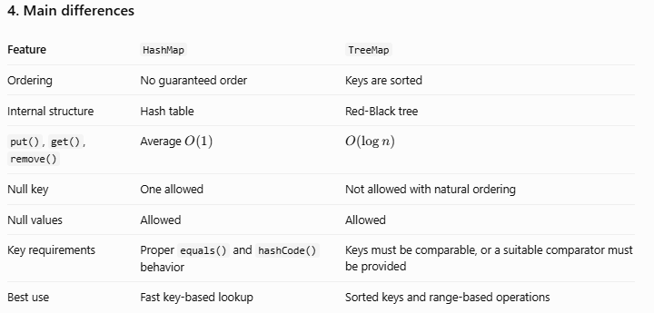

A TreeMap can support a null key only if its custom comparator explicitly supports nulls. With natural ordering, a null key is not allowed.
5. Real-world Spring Boot example
Imagine your application generates a report of employees by employee ID.

Using HashMap:
Map<Integer, String> employees = new HashMap<>();

Use it when you need fast key-value lookup and do not care about the order of entries.

Using TreeMap:
Map<Integer, String> employees = new TreeMap<>();

Use it when the report should automatically display employee IDs in sorted order.

For example, TreeMap is useful when you need to process keys within a range using operations such as subMap(), headMap(), or tailMap().
6. Interview-ready answer
You can remember and say:
HashMap and TreeMap both implement the Map interface, but they use different internal data structures. HashMap uses a hash table and provides average O(1) lookup, insertion, and removal when hash distribution is good, but it does not guarantee ordering. TreeMap uses a Red-Black tree and maintains keys in sorted order, with O(log n) lookup, insertion, and removal. I use HashMap when fast lookup is the priority and TreeMap when sorted keys or range-based operations are required.

Quick memory trick
HashMap → Fast lookup, no guaranteed order.

TreeMap → Sorted keys, \(O(\log n)\) operations.
=========================================================================================================================
51. How does TreeMap maintain sorted order in Java?
First, remember this simple rule:

TreeMap uses a Red-Black tree to keep keys sorted automatically.

By default, keys are sorted in ascending order. You can also provide a Comparator to define your own order. 

Oracle Docs

1. Simple Java example
Imagine you insert employee IDs in random order:
import java.util.Map;
import java.util.TreeMap;

public class Main {
    public static void main(String[] args) {

        Map<Integer, String> employees = new TreeMap<>();

        employees.put(103, "Amit");
        employees.put(101, "Rahul");
        employees.put(102, "Priya");

        System.out.println(employees);
    }
}

Output:
{101=Rahul, 102=Priya, 103=Amit}

Why are the keys sorted?

Because TreeMap compares the keys and places them in the appropriate positions in its tree. You do not need to sort the map manually.
2. How does it work internally?
Think of a tree where smaller keys go to the left and larger keys go to the right.

Suppose we insert 30, 10, and 20.

A simplified binary search tree might look like this:
30

10

20

Simplified illustration; TreeMap also balances its tree to maintain performance.

The actual TreeMap uses a Red-Black tree, which automatically balances itself when entries are inserted or removed. This keeps operations efficient. 

Oracle Docs

Here's what happens internally:
1. Compare the key: Java compares the new key with an existing key.
2. Choose a position: A smaller key goes left; a larger key goes right.
3. Insert the entry: Java adds the key-value pair at the correct position.
4. Balance the tree: If necessary, the Red-Black tree uses recoloring and rotations to keep the tree balanced.
5. Return sorted entries: Tree traversal returns keys in ascending order by default.
3. How does TreeMap compare keys?
By default, TreeMap uses the keys' natural ordering, such as the numeric order of integers or alphabetical order of Strings.
TreeMap<String, Integer> map = new TreeMap<>();

map.put("Banana", 20);
map.put("Apple", 10);
map.put("Mango", 30);

System.out.println(map);

Output:
{Apple=10, Banana=20, Mango=30}

You can also provide a Comparator to sort keys in descending order:
TreeMap<Integer, String> map =
        new TreeMap<>(Comparator.reverseOrder());

map.put(30, "Amit");
map.put(10, "Rahul");
map.put(20, "Priya");

System.out.println(map);

Output:
{30=Amit, 20=Priya, 10=Rahul}

The keys must be mutually comparable using their natural ordering or the supplied comparator.
4. What is the time complexity?
Operation	TreeMap
put()	\(O(\log n)\)
get()	\(O(\log n)\)
remove()	\(O(\log n)\)
Iterate through all entries	\(O(n)\)

The balanced tree keeps its height proportional to the logarithm of the number of entries. 

Oracle Docs

5. Interview-ready answer
TreeMap maintains sorted key order by using a self-balancing Red-Black tree. When we insert a key, Java compares it with existing keys and places it in the appropriate position. The tree uses rotations and recoloring when needed to maintain balance. By default, keys are sorted according to natural ordering, but we can provide a Comparator for custom ordering. TreeMap provides O(log n) time for insertion, lookup, and removal.

Quick memory trick
Compare keys → Insert in the correct position → Balance the tree → Get sorted keys.
=========================================================================================================================
52. What is the difference between HashSet, LinkedHashSet, and TreeSet?
First, remember this simple rule:
- HashSet → Unique elements, no guaranteed order.
- LinkedHashSet → Unique elements, insertion order maintained.
- TreeSet → Unique elements, sorted order maintained.
All three implement the Set interface, so they do not allow duplicate elements.
1. HashSet — no guaranteed order
Simple meaning
HashSet stores unique elements, but it does not guarantee the order in which they are displayed.
import java.util.HashSet;
import java.util.Set;

public class Main {
    public static void main(String[] args) {

        Set<Integer> numbers = new HashSet<>();

        numbers.add(30);
        numbers.add(10);
        numbers.add(20);
        numbers.add(10);

        System.out.println(numbers);
    }
}

Possible output:
[20, 10, 30]

The actual iteration order may differ.

Why? HashSet uses hashing to store elements and check for duplicates.

Remember: HashSet = Unique elements, order not guaranteed.
2. LinkedHashSet — insertion order
Simple meaning
LinkedHashSet stores unique elements and remembers the order in which elements were inserted.
import java.util.LinkedHashSet;
import java.util.Set;

public class Main {
    public static void main(String[] args) {

        Set<Integer> numbers = new LinkedHashSet<>();

        numbers.add(30);
        numbers.add(10);
        numbers.add(20);
        numbers.add(10);

        System.out.println(numbers);
    }
}

Output:
[30, 10, 20]

The second 10 is ignored because it is a duplicate. The original insertion order is preserved.

Remember: LinkedHashSet = Unique elements + insertion order.
3. TreeSet — sorted order
Simple meaning
TreeSet stores unique elements in sorted order.
import java.util.TreeSet;
import java.util.Set;

public class Main {
    public static void main(String[] args) {

        Set<Integer> numbers = new TreeSet<>();

        numbers.add(30);
        numbers.add(10);
        numbers.add(20);
        numbers.add(10);

        System.out.println(numbers);
    }
}

Output:
[10, 20, 30]

The elements are sorted in ascending order by default.

Remember: TreeSet = Unique elements + sorted order.
4. Understand the difference visually
HashSet
20
10
30

Order can vary; no ordering guarantee.

LinkedHashSet
30
10
20

Follows insertion order.

TreeSet
10
20
30

Sorted in ascending order by default.

5. Main differences
 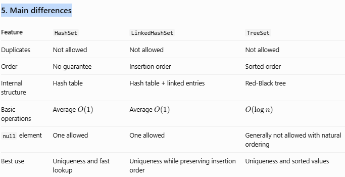

 The time complexities are typical, assuming good hash distribution for the hash-based sets.
6. Real-world Spring Boot example
Imagine an e-commerce application that stores product categories.

Use HashSet when you only need unique categories and don't care about the display order.

Use LinkedHashSet when categories should appear in the order they were first added.

Use TreeSet when categories must appear alphabetically, or numbers must remain sorted.

For example:
Set<String> categories = new TreeSet<>();

categories.add("Laptop");
categories.add("Accessories");
categories.add("Mobile");

System.out.println(categories);

Output:
[Accessories, Laptop, Mobile]

7. Interview-ready answer
HashSet, LinkedHashSet, and TreeSet all implement the Set interface and store unique elements. HashSet does not guarantee iteration order and generally provides average O(1) operations. LinkedHashSet maintains insertion order with similar average-time performance but uses additional memory for maintaining links. TreeSet maintains sorted order using a Red-Black tree, with O(log n) basic operations. I choose the implementation based on whether I need no ordering guarantee, insertion order, or sorted order.

Quick memory trick
HashSet → Unique.

LinkedHashSet → Unique + insertion order.

TreeSet → Unique + sorted order.

=========================================================================================================================
53. What is the difference between Comparable and Comparator?
Remember this simple rule:
- Comparable → Defines the natural sorting order inside the class.
- Comparator → Defines a sorting rule separately from the class.
A. Comparable
Suppose you have students and want to sort them by marks. The Student class can implement Comparable to define its natural order.
class Student implements Comparable<Student> {
    int marks;

    Student(int marks) {
        this.marks = marks;
    }

    @Override
    public int compareTo(Student other) {
        return Integer.compare(this.marks, other.marks);
    }
}

The compareTo() method defines how one student compares with another.
B. Comparator
Suppose sometimes you want to sort students by marks and sometimes by name. You can define separate comparators without changing the class.
students.sort(Comparator.comparingInt(s -> s.marks));

This sorts by marks. Other comparators can define different orders.
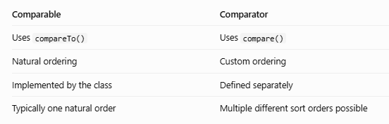
The Java API defines Comparable as a natural ordering mechanism and Comparator as a separate comparison function. 

Oracle Docs
+1

Interview-ready answer:
Comparable defines the natural ordering of objects through compareTo(), while Comparator defines custom ordering through compare(). I use Comparable when a class has a meaningful default order and Comparator when I need multiple sorting options, such as sorting employees by salary, name, or joining date.

=========================================================================================================================
54. What are fail-fast and fail-safe iterators?
Remember:
- Fail-fast → Detects unexpected structural modification and may throw ConcurrentModificationException.
- Snapshot or weakly consistent iterator → Allows certain concurrent modifications without the same fail-fast behavior.
The term fail-safe is informal, not an official Java iterator category.
A. Fail-fast example
List<Integer> numbers =
        new ArrayList<>(List.of(1, 2, 3, 4));

for (Integer number : numbers) {
    if (number == 2) {
        numbers.remove(number);
    }
}

With this example, an ArrayList iterator will throw ConcurrentModificationException when it detects the unexpected structural modification.

The safe alternative for this kind of removal is to use the iterator's own remove() method or use removeIf().
B. Snapshot iterator example
CopyOnWriteArrayList<Integer> numbers =
        new CopyOnWriteArrayList<>(List.of(1, 2, 3));

Iterator<Integer> iterator = numbers.iterator();

numbers.add(4);

while (iterator.hasNext()) {
    System.out.println(iterator.next());
}

Output:
1
2
3

The iterator sees the snapshot taken when it was created. It does not see the later addition of 4.
Main differences
Fail-fast	Snapshot / weakly consistent
Detects certain unexpected modifications	Designed to tolerate specified concurrent changes
May throw ConcurrentModificationException	Generally does not throw it for supported concurrent updates
Example: ArrayList iterator	Example: CopyOnWriteArrayList snapshot iterator
Helps detect programming mistakes	Helps support safe traversal in selected concurrent collections

Fail-fast detection is best-effort; Java does not guarantee that every concurrent modification will be detected. 

Oracle Docs
+1

Interview-ready answer:
Fail-fast iterators may throw ConcurrentModificationException when a collection is structurally modified unexpectedly during iteration. Snapshot iterators, such as those from CopyOnWriteArrayList, traverse a fixed snapshot. Some concurrent collections instead use weakly consistent iterators that can reflect certain concurrent updates. I choose the iterator behavior based on the collection and concurrency requirements.
=========================================================================================================================
55. What is the difference between Iterator and ListIterator?
Remember:
- Iterator → Moves forward through a collection.
- ListIterator → Moves forward and backward through a list.
A. Iterator
List<String> names =
        new ArrayList<>(List.of("Amit", "Priya", "Rahul"));

Iterator<String> iterator = names.iterator();

while (iterator.hasNext()) {
    System.out.println(iterator.next());
}

It provides methods such as hasNext(), next(), and optionally remove().
B. ListIterator
List<String> names =
        new ArrayList<>(List.of("Amit", "Priya", "Rahul"));

ListIterator<String> iterator = names.listIterator();

while (iterator.hasNext()) {
    System.out.println(iterator.next());
}

while (iterator.hasPrevious()) {
    System.out.println(iterator.previous());
}

ListIterator supports backward traversal as well as operations such as add() and set(), when supported by the list. 

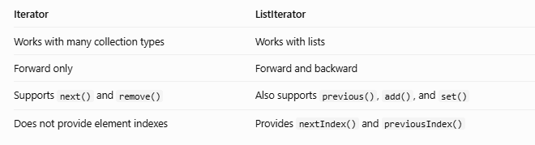
Interview-ready answer:
Iterator is a general mechanism for traversing a collection in the forward direction. ListIterator is specific to lists and supports bidirectional traversal, index access, and supported modification operations such as adding or replacing an element during iteration.

=========================================================================================================================
56. What is ConcurrentModificationException, and how can it occur?
Simple meaning: Java may throw this exception when a collection is modified unexpectedly while an iterator is traversing it.

It can happen even in a single thread. The word “concurrent” does not necessarily mean two threads. 

Oracle Docs

A. Incorrect approach
List<Integer> numbers =
        new ArrayList<>(List.of(1, 2, 3, 4));

for (Integer number : numbers) {
    if (number == 2) {
        numbers.remove(number);
    }
}

This modifies the list directly while its enhanced for loop iterator is active, so the iterator detects the structural change and throws ConcurrentModificationException in this example.
B. Correct approach — use Iterator.remove()
List<Integer> numbers =
        new ArrayList<>(List.of(1, 2, 3, 4));

Iterator<Integer> iterator = numbers.iterator();

while (iterator.hasNext()) {
    if (iterator.next() == 2) {
        iterator.remove();
    }
}

System.out.println(numbers);

Output:
[1, 3, 4]

Other suitable approaches include:
numbers.removeIf(number -> number == 2);

This is convenient when you want to remove elements that match a condition.

Important: If multiple threads share a collection, using an iterator correctly does not automatically make the entire collection thread-safe. Use suitable synchronization or a concurrent collection.

Interview-ready answer:
ConcurrentModificationException can occur when a fail-fast iterator detects an unexpected structural modification during iteration. It can happen in a single thread or across threads. I can prevent this in single-threaded removal logic by using Iterator.remove() or Collection.removeIf(). For concurrent access, I select an appropriate synchronization strategy or concurrent collection.
=========================================================================================================================
57. What is the difference between ArrayList and CopyOnWriteArrayList?
Remember:
- ArrayList → General-purpose list; not thread-safe by default.
- CopyOnWriteArrayList → Thread-safe list that copies its backing array when modified.
A. ArrayList
List<String> names = new ArrayList<>();

names.add("Amit");
names.add("Priya");

ArrayList is suitable for ordinary list operations when concurrent modification does not occur, or when proper external synchronization is provided.
B. CopyOnWriteArrayList
List<String> names = new CopyOnWriteArrayList<>();

names.add("Amit");
names.add("Priya");

This collection is designed for safe concurrent access. When it is modified, it generally creates a new backing array, allowing existing snapshot iterators to continue safely.

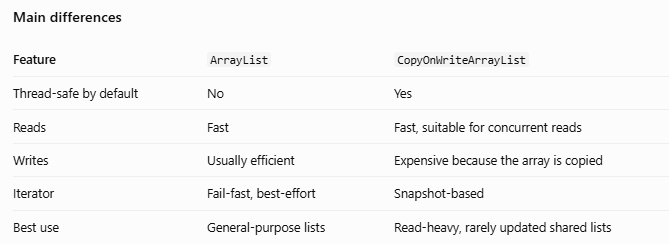
Snapshot traversal and the cost of copying on mutation are documented characteristics of this collection family. 

Oracle Docs

Real-world example
In a Spring Boot application, imagine keeping a list of event listeners. Many requests notify listeners, but new listeners are registered only occasionally.

CopyOnWriteArrayList may be a good choice because reads and iteration greatly outnumber updates.

If the list changes frequently, copying the array on each update can become expensive.

Interview-ready answer:
ArrayList is a general-purpose, non-thread-safe list. CopyOnWriteArrayList is thread-safe and creates a new backing array for mutations, so its iterators can traverse a stable snapshot. It is useful for read-heavy scenarios with infrequent updates, such as listener registries, but it is inefficient for workloads with frequent writes.
=========================================================================================================================
58. What is the difference between PriorityQueue and TreeSet?
Remember:
- PriorityQueue → Retrieves the next element according to priority.
- TreeSet → Stores unique elements in sorted order.
A. PriorityQueue
PriorityQueue<Integer> queue = new PriorityQueue<>();

queue.offer(30);
queue.offer(10);
queue.offer(20);

System.out.println(queue.poll());

Output:
10

By default, the smallest element has the highest priority. A comparator can change the order.

Important: Iterating over a PriorityQueue does not guarantee sorted order. Its head is the highest-priority element according to the configured ordering. 

Oracle Docs

B. TreeSet
TreeSet<Integer> numbers = new TreeSet<>();

numbers.add(30);
numbers.add(10);
numbers.add(20);
numbers.add(10);

System.out.println(numbers);

Output:
[10, 20, 30]

TreeSet maintains unique elements in sorted order. Its basic add(), remove(), and contains() operations take \(O(\log n)\) time. 

Oracle Docs

Main differences
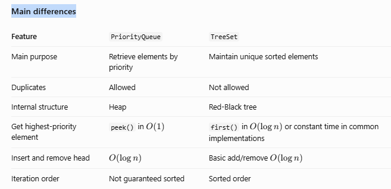
Real-world example
- Use PriorityQueue for processing tasks by urgency, scheduling the next job, or selecting the smallest pending value.
- Use TreeSet when you need unique, sorted values, such as distinct scores or sorted identifiers.
Interview-ready answer:
PriorityQueue is heap-based and is designed to retrieve elements by priority, while TreeSet uses a balanced tree to maintain unique elements in sorted order. PriorityQueue allows duplicates and does not guarantee sorted iteration, whereas TreeSet removes duplicates and keeps iteration sorted. I choose PriorityQueue for scheduling or repeatedly retrieving the next item and TreeSet for sorted uniqueness.
=========================================================================================================================
59. What is the time complexity of common HashMap operations?
Remember this simple rule:

HashMap operations are usually O(1) on average when keys are distributed well.

Here, n means the number of entries in the map.
Operation	Average / typical complexity
put(key, value)	O(1) amortized
get(key)	O(1)
remove(key)	O(1)
containsKey(key)	O(1)
containsValue(value)	O(n)
size()	O(1)
Iterate through all entries	O(capacity + n)
Resize the internal table	O(n)

These are typical complexity expectations, not guarantees that every individual operation takes constant time. Hash distribution, collisions, and resizing affect performance. 

Oracle Docs

Why is get() usually O(1)?
Map<Integer, String> employees = new HashMap<>();

employees.put(101, "Rahul");
employees.put(102, "Priya");

System.out.println(employees.get(102));

Output:
Priya

Java calculates the key's hash, locates a bucket, and searches the relevant entry or entries. With good distribution, it doesn't need to examine every entry.
Interview-ready answer
HashMap provides average O(1) performance for put, get, remove, and containsKey when hash distribution is good. Insertion is generally amortized O(1), although resizing can take O(n). The containsValue operation takes O(n) because it may scan all entries. In Java 8 and later, tree bins can improve searching in heavily collided buckets under suitable conditions.
=========================================================================================================================
60. How would you choose a collection for a high-performance application?
This is an important interview question because a senior developer should select a collection based on how the data will be used, not just which collection is familiar.
1. Choose according to the requirement
   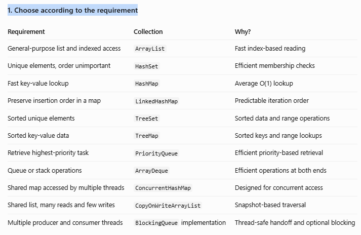
   2. Think about a real Spring Boot application
Imagine you are developing an e-commerce system.

Product API

Use ArrayList for an in-memory list of products when you need ordered iteration and indexed access.

Product lookup cache

Consider ConcurrentHashMap when multiple request-handling threads need to access a shared in-memory mapping safely.

Job processing

Use PriorityQueue when the application needs to repeatedly retrieve the next task according to priority. Use a BlockingQueue if concurrent producers and consumers need coordinated handoff.

Listener registry

Consider CopyOnWriteArrayList when many threads iterate through the listener list but updates are rare.

3. Five things I consider before choosing a collection
First: Operations. Do you read by index, search by key, check for duplicates, sort, or remove frequently?

Second: Ordering. Is insertion order required? Must the data remain sorted? Or is ordering irrelevant?

Third: Concurrency. Is the collection accessed by multiple threads? If so, use an appropriate concurrent collection or explicit synchronization.

Fourth: Memory and allocation. How large can the collection grow? Could resizing, object creation, or copying arrays create overhead?

Fifth: Measurement. Test realistic data sizes and workloads. Use profiling and benchmarking rather than assuming one collection is always fastest.
4. Interview-ready answer
I choose a collection based on the required operations, ordering, uniqueness, thread-safety, and memory constraints. For general-purpose lists, I usually start with ArrayList. For key-based lookup, I choose HashMap, or ConcurrentHashMap when shared concurrent access is required. For sorted keys or unique sorted values, I use TreeMap or TreeSet. For priority-based jobs, I choose PriorityQueue. In production, I also consider expected collection size, resizing, allocation overhead, and actual workload measurements before optimizing.
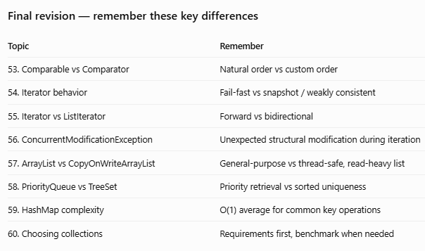

=========================================================================================================================
61. What are the major features introduced in Java 8?
Java 8 introduced features that made Java code shorter, more readable, and better suited to processing collections.

Remember these important features:
1. Lambda expressions — Write shorter implementations of functional interfaces.
2. Functional interfaces — Interfaces with one abstract method.
3. Stream API — Process collections using operations such as filtering, mapping, and sorting.
4. Method references — Refer to an existing method using ::.
5. Default and static interface methods — Add certain implementations directly to interfaces.
6. Optional — Represent a value that may be absent.
7. New Date and Time API — Classes such as LocalDate, LocalDateTime, and ZonedDateTime.
8. CompletableFuture — Compose asynchronous tasks.
9. Base64 API — Encode and decode Base64 data.
10. Collection enhancements — Methods such as forEach(), removeIf(), and computeIfAbsent().
Example: Before and after Java 8 style

Traditional loop:
for (String name : names) {
    if (name.startsWith("A")) {
        System.out.println(name);
    }
}

Java 8 Stream API:
names.stream()
     .filter(name -> name.startsWith("A"))
     .forEach(System.out::println);

Interview answer: Java 8 introduced lambdas, functional interfaces, Streams, method references, Optional, default interface methods, the new Date and Time API, and CompletableFuture. These features support more concise, declarative, and functional-style programming.
62. What is a functional interface?
A functional interface is an interface with exactly one abstract method.

It can also contain default methods, static methods, and methods matching public Object methods.

Example:
@FunctionalInterface
interface Calculator {
    int add(int a, int b);
}

We can implement it using a lambda expression:
Calculator calculator = (a, b) -> a + b;

System.out.println(calculator.add(10, 20));

Output:
30

The lambda provides the implementation of add().

Common functional interfaces in Java include:
Interface	Purpose
Predicate<T>	Tests a condition and returns boolean
Function<T, R>	Converts an input into an output
Consumer<T>	Accepts a value and returns no result
Supplier<T>	Supplies a value
Runnable	Represents a task with no arguments or result
Comparator<T>	Compares two objects

Interview answer: A functional interface has one abstract method and can be implemented using a lambda expression or method reference. Examples include Predicate, Function, Consumer, and Supplier.
=========================================================================================================================
63. What is the purpose of the @FunctionalInterface annotation?
The @FunctionalInterface annotation tells the compiler that an interface is intended to be a functional interface.

Example:
@FunctionalInterface
interface Greeting {
    void sayHello();
}

This is valid.

But this is invalid:
@FunctionalInterface
interface Greeting {
    void sayHello();
    void sayGoodbye();
}

The compiler reports an error because there are two abstract methods.

Important: The annotation is optional. An interface can still be a functional interface without it. The annotation simply helps the compiler catch mistakes.

Interview answer: @FunctionalInterface documents the intention and allows compile-time verification that the interface meets the functional-interface rules.
=========================================================================================================================
64. What is a lambda expression?
A lambda expression is a short way to provide an implementation of a functional interface.

General syntax:
(parameters) -> expression

Example:
@FunctionalInterface
interface Greeting {
    void sayHello(String name);
}

public class Main {
    public static void main(String[] args) {

        Greeting greeting =
                name -> System.out.println("Hello " + name);

        greeting.sayHello("Rahul");
    }
}

Output:
Hello Rahul

Here:
- name is the parameter.
- -> separates the parameters from the body.
- The body defines what the lambda does.
Real-world use: Lambdas are frequently used with Streams for filtering, sorting, and transforming data.

Interview answer: A lambda expression provides a concise implementation of a functional interface without requiring a separate implementation class.
=========================================================================================================================
65. What is the difference between a lambda expression and an anonymous inner class?
Both can provide an implementation of an interface or extend a class, but they work differently.
Anonymous inner class
Runnable task = new Runnable() {
    @Override
    public void run() {
        System.out.println("Task running");
    }
};

Lambda expression
Runnable task = () ->
        System.out.println("Task running");

Both can implement the Runnable interface, but the lambda syntax is shorter.
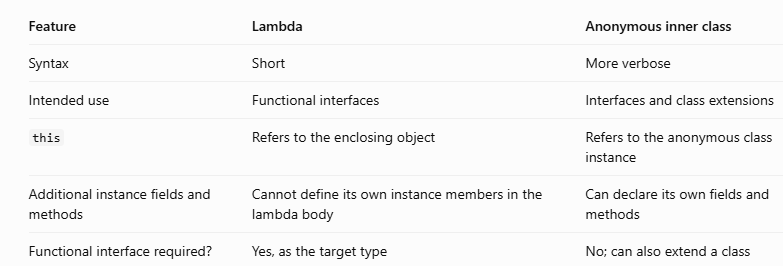
Important: A lambda is not simply an anonymous class with shorter syntax. Java implements lambda expressions differently.

Interview answer: Lambdas provide concise implementations of functional interfaces. Anonymous inner classes create an unnamed class instance and can declare their own fields and methods. A particularly important difference is how this behaves.
=========================================================================================================================
66. What are method references?
A method reference is a shorter way to refer to an existing method when its signature matches the required functional interface.

The syntax uses ::.
Example 1: Static method reference
Function<String, Integer> parser =
        Integer::parseInt;

System.out.println(parser.apply("123"));

Output:
123

Example 2: Instance method reference
List<String> names = List.of("Rahul", "Priya");

names.forEach(System.out::println);

System.out::println refers to the existing println() method.
Example 3: Constructor reference
Supplier<ArrayList<String>> supplier =
        ArrayList::new;

ArrayList<String> list = supplier.get();

Common method-reference forms:
- ClassName::staticMethod
- object::instanceMethod
- ClassName::instanceMethod
- ClassName::new
Interview answer: Method references are shorthand for lambdas that call existing methods or constructors. They improve readability when no additional logic is needed.
=========================================================================================================================
67. What is the Stream API?
The Stream API provides a way to process data through a sequence of operations such as filtering, mapping, sorting, and collecting results.

Example:
List<Integer> numbers =
        List.of(10, 15, 20, 25, 30);

List<Integer> result = numbers.stream()
        .filter(n -> n > 20)
        .toList(); // Java 16+

System.out.println(result);

Output:
[25, 30]

For Java 8, replace .toList() with .collect(Collectors.toList()).
How does it work?
1. stream() creates a stream from the list.
2. filter() keeps numbers greater than 20.
3. The terminal operation collects the results into a list.
Important: A Stream does not store the data itself. It processes data from a source, and a stream generally cannot be reused after a terminal operation.

Interview answer: The Stream API processes data declaratively through pipelines of intermediate and terminal operations. It supports readable data transformations and can also support parallel processing when appropriate.
=========================================================================================================================
68. What is the difference between a Collection and a Stream?
Think of a collection as a container of data and a stream as a way to process data.
List<Integer> numbers =
        new ArrayList<>(List.of(10, 20, 30));

List<Integer> result = numbers.stream()
        .filter(n -> n > 10)
        .collect(Collectors.toList());

The numbers collection stores the values. The stream processes them and collects the matching values into a new list.
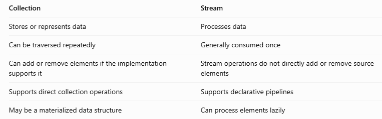
Interview answer: A Collection represents a group of elements, whereas a Stream represents a sequence of operations for processing data from a source. Collections can generally be traversed repeatedly, while a Stream is intended to be consumed once.

=========================================================================================================================
69. What is the difference between intermediate and terminal operations?
A Stream pipeline consists of intermediate operations followed by a terminal operation.
A. Intermediate operations
These return another Stream and are generally lazy.

Examples:
- filter()
- map()
- flatMap()
- distinct()
- sorted()
- limit()
- skip()
B. Terminal operations
These trigger the pipeline and produce a result or side effect.

Examples:
- collect()
- forEach()
- count()
- reduce()
- findFirst()
- anyMatch()
Example:
List<String> names =
        List.of("Amit", "Anita", "Rahul");

long count = names.stream()
        .filter(name -> name.startsWith("A"))
        .count();

System.out.println(count);

Output:
2

Here, filter() is intermediate, and count() is terminal.

Interview answer: Intermediate operations transform a stream and are generally lazy. Terminal operations trigger processing and produce a result or side effect.
=========================================================================================================================
70. What is the difference between map() and flatMap()?
Remember:
- map() → Transforms each element into another value.
- flatMap() → Transforms each element and flattens the resulting streams into one stream.
A. map() example
List<String> names =
        Arrays.asList("rahul", "priya");

List<String> result = names.stream()
        .map(String::toUpperCase)
        .collect(Collectors.toList());

System.out.println(result);

Output:
[RAHUL, PRIYA]

Each name is transformed individually.
B. flatMap() example
Suppose you have a list of lists.
List<List<String>> data = Arrays.asList(
    Arrays.asList("A", "B"),
    Arrays.asList("C", "D")
);

List<String> result = data.stream()
        .flatMap(List::stream)
        .collect(Collectors.toList());

System.out.println(result);

Output:
[A, B, C, D]

flatMap() converts each inner list into a stream and combines the elements into one flat stream.
map()	flatMap()
One input produces one output value	One input can produce zero or more output values
May produce nested structures	Flattens nested streams
Example: String to uppercase	Example: List of lists to one list

Interview answer: map() transforms each element, while flatMap() transforms each element into a stream or similar structure and then flattens the results into one stream.
=========================================================================================================================
71. What is the difference between filter() and map()?
Remember:
- filter() → Selects elements.
- map() → Transforms elements.
Example
List<Integer> numbers =
        Arrays.asList(10, 15, 20, 25);

List<Integer> result = numbers.stream()
        .filter(n -> n > 15)
        .map(n -> n * 2)
        .collect(Collectors.toList());

System.out.println(result);

Output:
[40, 50]

How does it work?
1. filter() keeps 20 and 25.
2. map() doubles them to 40 and 50.
3. collect() stores the results in a list.
filter()	map()
Keeps or rejects each element	Transforms each element
Takes a Predicate	Takes a Function
Output contains selected original elements	Output contains transformed elements

Interview answer: I use filter() to select data based on a condition and map() to convert each selected element into another value.
=========================================================================================================================
72. What is the difference between findFirst() and findAny()?
Both return an Optional containing an element, if one is available.
Example
List<Integer> numbers =
        Arrays.asList(10, 20, 30, 40);

Optional<Integer> first = numbers.stream()
        .filter(n -> n > 15)
        .findFirst();

System.out.println(first.get());

Output:
20

findFirst() returns the first matching element according to the stream's encounter order, if that order exists.

Example with findAny():
Optional<Integer> result = numbers.stream()
        .filter(n -> n > 15)
        .findAny();

For this sequential stream, the result will ordinarily be the first matching element. However, findAny() does not promise that result, especially with parallel streams.
findFirst()	findAny()
Respects encounter order when defined	May return any matching element
Useful when the first element matters	Useful when any matching element is acceptable
May constrain parallel processing to preserve order	Can offer more flexibility for parallel processing

Interview answer: findFirst() is used when the first matching element matters. findAny() is useful when any matching element is acceptable, particularly in parallel processing.
=========================================================================================================================
73. What is the difference between orElse() and orElseGet() in Optional?
Remember:
- orElse() → Evaluates the fallback argument before the method call.
- orElseGet() → Calls the supplier only when the Optional is empty.
Example
String name = Optional.of("Rahul")
        .orElse(getDefaultName());

Here, getDefaultName() is evaluated even though the Optional contains "Rahul".

Now consider:
String name = Optional.of("Rahul")
        .orElseGet(() -> getDefaultName());

The fallback method is not called because a value is already present.

Helper method:
static String getDefaultName() {
    System.out.println("Fallback called");
    return "Guest";
}

orElse()	orElseGet()
Takes a fallback value	Takes a Supplier
Fallback expression is evaluated eagerly	Supplier runs only if needed
Suitable for inexpensive fallback values	Useful for expensive fallback computations

Interview answer: orElse() eagerly evaluates its fallback argument, whereas orElseGet() evaluates its supplier lazily when the Optional is empty. I prefer orElseGet() when creating the fallback is expensive.
=========================================================================================================================
74. How do you handle null values using Optional?
Optional represents a value that may be present or absent.
Example
String name = null;

String result = Optional.ofNullable(name)
        .map(String::toUpperCase)
        .orElse("GUEST");

System.out.println(result);

Output:
GUEST

Let's understand the methods:
- Optional.of(value) — Use when the value must not be null; throws NullPointerException for null.
- Optional.ofNullable(value) — Creates an empty Optional if the value is null.
- map() — Transforms a present value.
- orElse() — Provides a fallback value.
- orElseThrow() — Throws an exception if the Optional is empty.
Important: Avoid calling get() without checking whether a value is present. Also, Optional is mainly intended for representing potentially missing return values, not as a replacement for every nullable field or method parameter.

Interview answer: I use Optional.ofNullable() to represent a potentially null value and then use methods such as map(), orElse(), or orElseThrow() to handle the absent case explicitly.
75. What is the difference between reduce() and collect()?
Remember:
- reduce() → Combines elements into a single result.
- collect() → Accumulates elements into a result container or another collected result.
A. reduce() example
Find the total of numbers:
List<Integer> numbers =
        Arrays.asList(10, 20, 30);

int total = numbers.stream()
        .reduce(0, Integer::sum);

System.out.println(total);

Output:
60

B. collect() example
Collect numbers into a list:
List<Integer> result = numbers.stream()
        .filter(n -> n > 10)
        .collect(Collectors.toList());

System.out.println(result);

Output:
[20, 30]

reduce()	collect()
Combines values into one result	Accumulates values into a collection or other result
Common for sums and products	Common for lists, maps, and grouping
Reduction function should generally be associative for safe parallel use	Collector coordinates accumulation and combination

Interview answer: I use reduce() for combining elements into a single result, such as a sum. I use collect() when I need to build a collection, group data, or create a map.
76. What is the difference between groupingBy() and partitioningBy()?
Remember:
- groupingBy() → Creates groups based on a classifier.
- partitioningBy() → Divides elements into two groups based on a boolean condition.
A. groupingBy() example
List<String> names =
        Arrays.asList("Amit", "Anita", "Rahul");

Map<Integer, List<String>> groups = names.stream()
        .collect(Collectors.groupingBy(String::length));

System.out.println(groups);

Output:
{4=[Amit], 5=[Anita, Rahul]}

The strings are grouped according to their length.
B. partitioningBy() example
Map<Boolean, List<Integer>> result =
        Arrays.asList(10, 15, 20, 25).stream()
        .collect(Collectors.partitioningBy(n -> n > 15));

System.out.println(result);

Output:
{false=[10, 15], true=[20, 25]}

groupingBy()	partitioningBy()
Can create many groups	Creates two groups: true and false
Groups using a classifier	Groups using a predicate
Example: Employees by department	Example: Employees above/below a salary threshold

Interview answer: I use groupingBy() when I need multiple groups, such as employees grouped by department. I use partitioningBy() when I need exactly two groups based on a condition.
=========================================================================================================================
77. How do you find duplicate elements in a list using Streams?
We can use a Set to track elements we have already seen.
List<Integer> numbers =
        Arrays.asList(10, 20, 30, 20, 40, 10, 10);

Set<Integer> seen = new HashSet<>();

Set<Integer> duplicates = numbers.stream()
        .filter(n -> !seen.add(n))
        .collect(Collectors.toSet());

System.out.println(duplicates);

Possible output:
[20, 10]

How does it work?
- seen.add(n) returns true when an element is newly added.
- It returns false when the element is already present.
- !seen.add(n) therefore selects repeated occurrences.
This example is intended for a sequential stream. It uses mutable state inside the stream pipeline and should not be changed to parallelStream() without redesigning it.

If you need duplicate reporting in production, another option is to group elements by value and count them, then retain elements whose count exceeds one.

Interview answer: I use a set to track elements already encountered and filter repeated occurrences. For parallel processing, I avoid this shared-state approach and prefer a collector-based frequency calculation.
78. How do you find the second-highest salary using Streams?
Suppose Employee has a numeric getSalary() method.
Optional<Integer> secondHighestSalary = employees.stream()
        .map(Employee::getSalary)
        .distinct()
        .sorted(Comparator.reverseOrder())
        .skip(1)
        .findFirst();

To print the result:
System.out.println(
    secondHighestSalary.orElseThrow(
        () -> new IllegalArgumentException(
            "Second-highest distinct salary not found"
        )
    )
);

Understand the logic
1. map() extracts salaries from employees.
2. distinct() removes repeated salary values.
3. sorted(Comparator.reverseOrder()) sorts from highest to lowest.
4. skip(1) skips the highest distinct salary.
5. findFirst() retrieves the next salary.
For example, salaries [50000, 80000, 80000, 60000] produce a second-highest distinct salary of 60000.

Interview-ready answer: I extract salaries, remove duplicates, sort in descending order, skip the highest salary, and retrieve the next one. This finds the second-highest distinct salary; if the business definition considers duplicate salaries differently, I adjust the logic accordingly.
=========================================================================================================================
79. How do you group employees by department?
Use Collectors.groupingBy().
Map<String, List<Employee>> employeesByDepartment =
        employees.stream()
                .collect(Collectors.groupingBy(
                        Employee::getDepartment
                ));

The resulting map associates each department with a list of employees in that department.

For example:
IT       → [Rahul, Amit]
Finance  → [Priya, Neha]

Real-world use: This is useful for preparing reports, department summaries, or grouped API output.

Interview answer: I use Collectors.groupingBy(Employee::getDepartment) to create a map where each department is a key and the corresponding value is a list of its employees.
80. How do you convert a list into a Map using Streams?
Use Collectors.toMap().

Suppose each employee has a unique employee ID:
Map<Long, Employee> employeeMap = employees.stream()
        .collect(Collectors.toMap(
                Employee::getId,
                Function.identity()
        ));

Here:
- Employee::getId supplies the key.
- Function.identity() keeps the employee object as the value.
The result maps employee IDs to their employees.

Important: If duplicate keys occur, toMap() throws IllegalStateException unless you supply a merge function.
=========================================================================================================================
81. How do you handle duplicate keys in Collectors.toMap()?
Provide a merge function that explains what to do when keys collide.

For example, if multiple employees share the same department and you want to keep one employee per department:
Map<String, Employee> employeeByDepartment =
        employees.stream()
                .collect(Collectors.toMap(
                        Employee::getDepartment,
                        Function.identity(),
                        (existing, replacement) -> existing
                ));

The merge function keeps the existing employee when the same department appears again.

Other choices include keeping the replacement or combining values, depending on the business requirement.

For example, to sum numbers that share the same key:
Map<String, Integer> totals = entries.stream()
        .collect(Collectors.toMap(
                Entry::getKey,
                Entry::getValue,
                Integer::sum
        ));

Interview answer: I handle duplicate keys by providing a merge function to Collectors.toMap(). The function defines whether to keep the existing value, keep the new value, or combine both values. The correct strategy depends on the business rule.
=========================================================================================================================

=========================================================================================================================

=========================================================================================================================

=========================================================================================================================

=========================================================================================================================

=========================================================================================================================

=========================================================================================================================

=========================================================================================================================

=========================================================================================================================

=========================================================================================================================

=========================================================================================================================

=========================================================================================================================

=========================================================================================================================

=========================================================================================================================

=========================================================================================================================

=========================================================================================================================

=========================================================================================================================

=========================================================================================================================

=========================================================================================================================

=========================================================================================================================

=========================================================================================================================

=========================================================================================================================

=========================================================================================================================

=========================================================================================================================

=========================================================================================================================

=========================================================================================================================

=========================================================================================================================

=========================================================================================================================

=========================================================================================================================

=========================================================================================================================

=========================================================================================================================

=========================================================================================================================

=========================================================================================================================

=========================================================================================================================

=========================================================================================================================

=========================================================================================================================

=========================================================================================================================

=========================================================================================================================

=========================================================================================================================

=========================================================================================================================

=========================================================================================================================

=========================================================================================================================

=========================================================================================================================

=========================================================================================================================

=========================================================================================================================

=========================================================================================================================

=========================================================================================================================

=========================================================================================================================